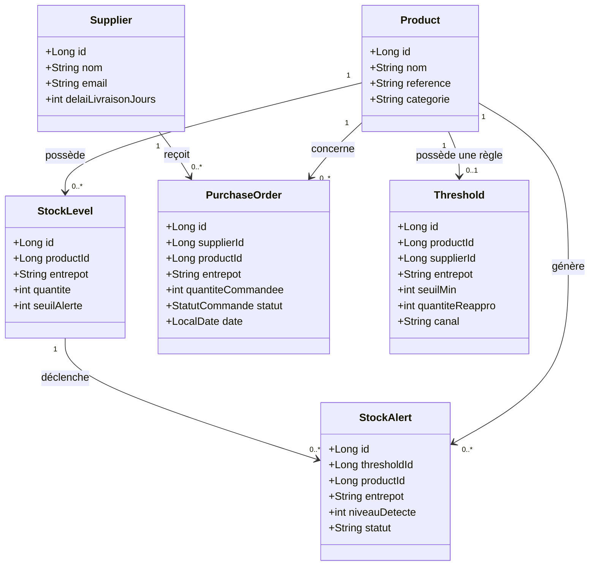
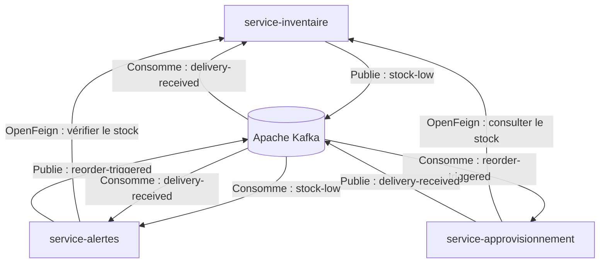
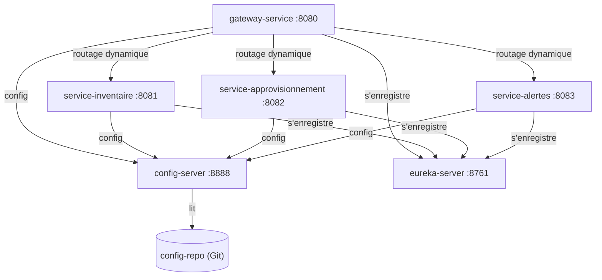
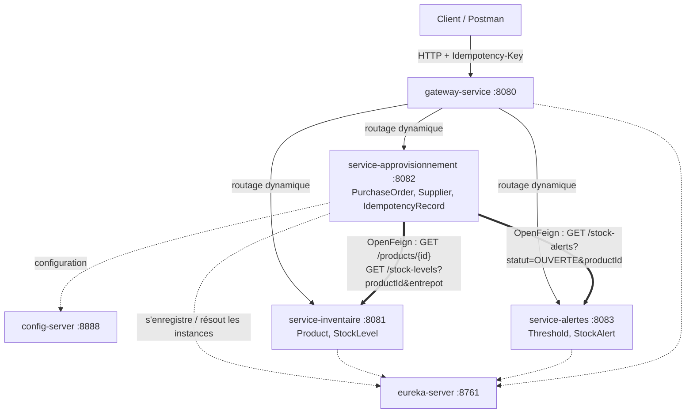
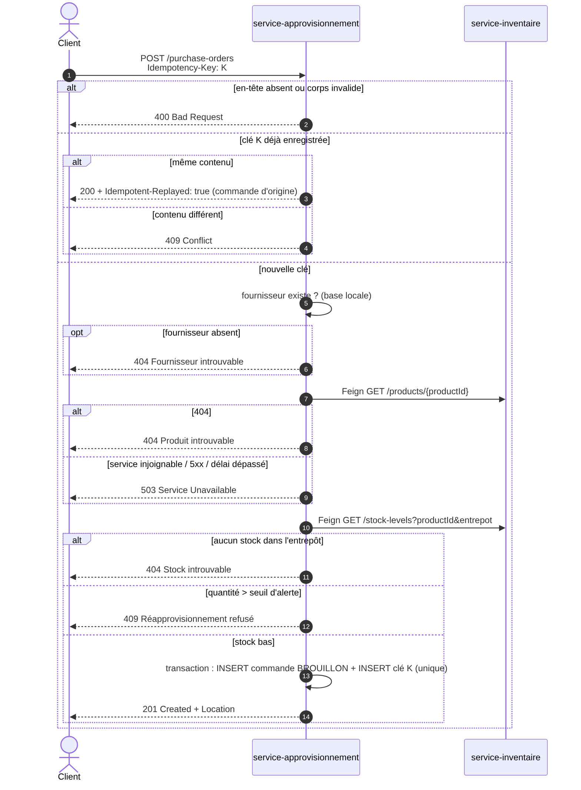
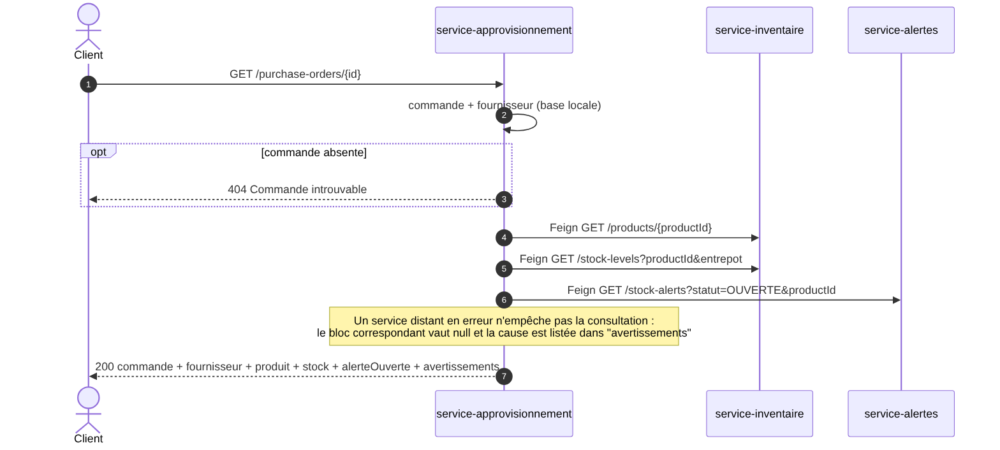
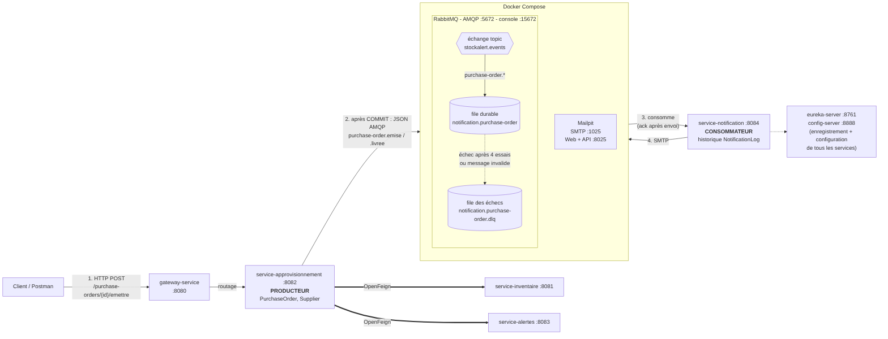
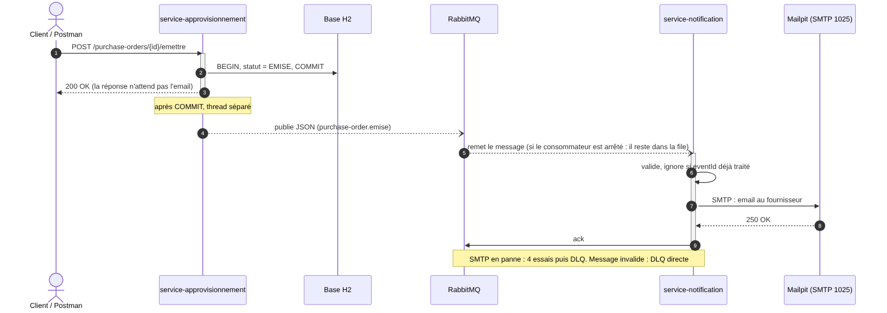

# Stock-Alert — Gestion intelligente des stocks

Application distribuée de gestion des stocks multi-entrepôts avec détection des ruptures, alertes automatiques et réapprovisionnement via des commandes d'achat.

## Présentation du projet

**Stock-Alert** vise à automatiser le cycle de réapprovisionnement. Lorsqu'une sortie de stock fait passer la quantité disponible sous un seuil défini, une alerte est créée et un processus de commande auprès d'un fournisseur est déclenché.

À la réception de la livraison, le stock est mis à jour et l'alerte correspondante est clôturée.

### Objectifs

- Gérer les produits et les stocks de plusieurs entrepôts.
- Détecter automatiquement les risques de rupture.
- Centraliser les fournisseurs et les commandes d'achat.
- Automatiser le processus de réapprovisionnement.
- Assurer la communication entre les microservices.
- Garantir le suivi du cycle de vie des commandes et des alertes.

> **Unité de traitement principale : la commande d'achat**
>
> Cycle de vie : `BROUILLON → EMISE → LIVREE`

## Architecture fonctionnelle

Le système repose sur trois microservices métier, chacun responsable d'un domaine fonctionnel distinct.

### 1. `service-inventaire`

Responsable du référentiel des produits et de la gestion des quantités par entrepôt.

| Entité | Responsabilité | Attributs principaux |
|---|---|---|
| `Product` | Référentiel des produits | `id`, `nom`, `reference`, `categorie` |
| `StockLevel` | Stock d'un produit dans un entrepôt | `id`, `productId`, `entrepot`, `quantite`, `seuilAlerte` |

### 2. `service-approvisionnement`

Service principal de gestion des fournisseurs et des commandes d'achat.

| Entité | Responsabilité | Attributs principaux |
|---|---|---|
| `Supplier` | Référentiel des fournisseurs | `id`, `nom`, `email`, `delaiLivraisonJours` |
| `PurchaseOrder` | Commande d'achat fournisseur | `id`, `supplierId`, `productId`, `entrepot`, `quantiteCommandee`, `statut`, `date` |

Chaque commande concerne un produit, un fournisseur, une quantité et un statut.

### 3. `service-alertes`

Responsable de la définition des seuils et du suivi des ruptures de stock.

| Entité | Responsabilité | Attributs principaux |
|---|---|---|
| `Threshold` | Règle de réapprovisionnement | `id`, `productId`, `supplierId`, `entrepot`, `seuilMin`, `quantiteReappro`, `canal` |
| `StockAlert` | Alerte de rupture | `id`, `thresholdId`, `productId`, `entrepot`, `niveauDetecte`, `statut` |

## Diagramme de classes UML

Ce diagramme présente les principales entités métier, leurs attributs et les relations logiques entre les produits, les stocks, les fournisseurs, les commandes et les alertes.



> Les relations de ce diagramme représentent le modèle métier cible. Elles devront correspondre aux associations et aux clés étrangères réellement implémentées dans les classes Java.

## Architecture technique

L'architecture repose sur trois microservices métier qui communiquent de manière synchrone avec OpenFeign et de manière asynchrone à travers Apache Kafka.



### Rôle des microservices

- **Inventaire :** gère les produits, les stocks et la détection des seuils bas.
- **Alertes :** gère les règles de seuil, crée les alertes et déclenche le réapprovisionnement.
- **Approvisionnement :** gère les fournisseurs, les commandes d'achat et la réception des livraisons.
- **Apache Kafka :** transporte les événements métier entre les services.

## Communication entre les microservices

### Communication synchrone — OpenFeign

OpenFeign permet à un microservice d'appeler une API REST d'un autre microservice et d'obtenir une réponse immédiate.

- **Approvisionnement → Inventaire :** vérifier le produit et le stock avant d'enregistrer une commande d'achat *(implémenté au jalon V4)*.
- **Approvisionnement → Alertes :** enrichir la consultation d'une commande avec l'alerte ouverte *(implémenté au jalon V4)*.
- **Alertes → Inventaire :** vérifier que le stock est sous le seuil avant de créer une alerte *(à venir)*.

### Communication asynchrone — Apache Kafka

Kafka permet de transmettre des événements métier sans imposer un appel direct entre le producteur et le consommateur.

| Événement | Producteur | Consommateur(s) | Traitement |
|---|---|---|---|
| `stock-low` | `service-inventaire` | `service-alertes` | Créer une alerte à partir de la règle de seuil |
| `reorder-triggered` | `service-alertes` | `service-approvisionnement` | Créer et émettre une commande d'achat |
| `delivery-received` | `service-approvisionnement` | `service-inventaire`, `service-alertes` | Mettre à jour le stock et clôturer l'alerte |

## Scénario métier : du stock bas à la livraison

1. Une sortie de stock est enregistrée dans un entrepôt.
2. Le service d'inventaire détecte que la quantité passe sous le seuil d'alerte et publie l'événement `stock-low`.
3. Le service d'alertes reçoit l'événement, vérifie le stock auprès du service d'inventaire et consulte la règle `Threshold`.
4. Une `StockAlert` est créée pour le produit et l'entrepôt concernés.
5. Le service d'alertes publie `reorder-triggered` avec les informations nécessaires au réapprovisionnement.
6. Le service d'approvisionnement identifie le fournisseur et crée une `PurchaseOrder` au statut `BROUILLON`.
7. La commande est transmise au fournisseur et son statut passe à `EMISE`.
8. À la réception de la livraison, la commande passe à `LIVREE` et l'événement `delivery-received` est publié.
9. Le service d'inventaire met à jour la quantité disponible.
10. Le service d'alertes clôture l'alerte correspondante.

## Technologies

La stack technique cible comprend :

- **Langage :** Java 17 minimum
- **Framework backend :** Spring Boot
- **Communication synchrone :** Spring Cloud OpenFeign
- **Messagerie asynchrone :** RabbitMQ (notifications par email, jalon V5) ; Apache Kafka envisagé pour les événements métier entre services
- **Envoi d'emails :** Spring Mail + Mailpit (faux serveur SMTP de développement)
- **Conteneurs :** Docker Compose (RabbitMQ, Mailpit)
- **Persistance :** Spring Data JPA
- **Base de données :** H2 en mémoire (V1) — PostgreSQL envisagé pour la suite
- **Gestion des dépendances :** Maven
- **Environnement de développement :** IntelliJ IDEA
- **Tests d'API :** Postman, Swagger UI (springdoc-openapi)

> Cette liste correspond aux technologies envisagées pour le projet. Elle doit être ajustée selon les dépendances et les composants réellement configurés dans le dépôt.

## Structure du dépôt

```text
projetstock_alert/
├── pom.xml                      # POM agrégateur (3 modules)
├── service-inventaire/          # port 8081 — Product, StockLevel
├── service-approvisionnement/   # port 8082 — Supplier, PurchaseOrder
├── service-alertes/             # port 8083 — Threshold, StockAlert
├── service-notification/        # port 8084 — consommateur RabbitMQ, envoi d'emails (V5)
├── eureka-server/, gateway-service/, config-server/, config-repo/   # infrastructure (V2, V3)
├── docker-compose.yml           # RabbitMQ + Mailpit (V5)
├── docs/                        # schémas (.mmd + .png) et tests Postman documentés
├── postman/                     # collections de tests Postman
└── README.md
```

Chaque module est une application Spring Boot autonome, avec son propre POM, sa propre base H2 en mémoire et la même organisation en couches :

```text
com.stockalert.<service>/
├── controller/   # API REST (codes HTTP, @Valid)
├── service/      # règles métier, transactions
├── repository/   # Spring Data JPA
├── entite/       # entités JPA
├── dto/          # DTO validés (Jakarta Validation)
├── mapper/       # MapStruct entité <-> DTO
└── exception/    # exceptions métier + @RestControllerAdvice
```

## Jalon V1 — Services métier indépendants

Livrables : trois services opérationnels (Controller / Service / Repository), DTO validés, API REST avec codes HTTP adaptés et gestion centralisée des erreurs, données propres à chaque service. Aucun appel entre services à ce stade : OpenFeign et Kafka arrivent aux jalons suivants (les points d'intégration sont signalés par des commentaires `Jalon suivant` dans le code).

### Prérequis

- JDK 17 ou supérieur, Maven (ou le wrapper `mvnw` fourni), IntelliJ IDEA.

### Compiler et lancer

```powershell
.\mvnw.cmd clean verify

.\mvnw.cmd -pl service-inventaire spring-boot:run
.\mvnw.cmd -pl service-approvisionnement spring-boot:run
.\mvnw.cmd -pl service-alertes spring-boot:run
```

Dans IntelliJ : ouvrir le `pom.xml` racine (*Load Maven Project*), puis lancer chaque classe `Service...Application` (trois configurations d'exécution distinctes).

| Service | Port | Swagger UI | Console H2 |
|---|---|---|---|
| service-inventaire | 8081 | http://localhost:8081/swagger-ui/index.html | http://localhost:8081/h2-console (`jdbc:h2:mem:inventairedb`, user `sa`) |
| service-approvisionnement | 8082 | http://localhost:8082/swagger-ui/index.html | http://localhost:8082/h2-console (`jdbc:h2:mem:approvisionnementdb`) |
| service-alertes | 8083 | http://localhost:8083/swagger-ui/index.html | http://localhost:8083/h2-console (`jdbc:h2:mem:alertesdb`) |

Les bases sont recréées et alimentées par `data.sql` à chaque démarrage.

### Endpoints

**service-inventaire**

| Méthode | URL | Description | Codes |
|---|---|---|---|
| GET / POST | `/products` | Lister / créer un produit | 200 / 201, 400, 409 (référence en double) |
| GET / PUT / DELETE | `/products/{id}` | Consulter / modifier / supprimer | 200, 204, 400, 404, 409 (stock rattaché) |
| GET / POST | `/stock-levels` | Lister (`?productId=&entrepot=`) / créer | 200 / 201, 400, 404 (produit), 409 (doublon produit+entrepôt) |
| GET / PUT / DELETE | `/stock-levels/{id}` | Consulter / modifier / supprimer | 200, 204, 400, 404, 409 |
| POST | `/stock-levels/{id}/sortie` | Sortie de stock `{"quantite": n}` | 200, 400, 404, 409 (stock insuffisant) |
| POST | `/stock-levels/{id}/entree` | Entrée de stock `{"quantite": n}` | 200, 400, 404 |

**service-approvisionnement**

| Méthode | URL | Description | Codes |
|---|---|---|---|
| GET / POST | `/suppliers` | Lister / créer un fournisseur | 200 / 201, 400 |
| GET / PUT / DELETE | `/suppliers/{id}` | Consulter / modifier / supprimer | 200, 204, 400, 404, 409 (commandes rattachées) |
| GET / POST | `/purchase-orders` | Lister (`?statut=&supplierId=`) / créer (statut `BROUILLON`) | 200 / 201, 400, 404 (fournisseur) |
| GET / PUT / DELETE | `/purchase-orders/{id}` | Consulter / modifier / supprimer (`BROUILLON` seulement) | 200, 204, 400, 404, 409 |
| POST | `/purchase-orders/{id}/emettre` | `BROUILLON` → `EMISE` | 200, 404, 409 |
| POST | `/purchase-orders/{id}/livrer` | `EMISE` → `LIVREE` | 200, 404, 409 |

**service-alertes**

| Méthode | URL | Description | Codes |
|---|---|---|---|
| GET / POST | `/thresholds` | Lister / créer une règle de seuil | 200 / 201, 400, 409 (doublon produit+entrepôt) |
| GET / PUT / DELETE | `/thresholds/{id}` | Consulter / modifier / supprimer | 200, 204, 400, 404, 409 (alertes rattachées) |
| GET / POST | `/stock-alerts` | Lister (`?statut=&productId=`) / créer une alerte `OUVERTE` | 200 / 201, 400, 404 (règle), 409 (alerte ouverte existante) |
| GET / DELETE | `/stock-alerts/{id}` | Consulter / supprimer | 200, 204, 404 |
| POST | `/stock-alerts/{id}/cloturer` | `OUVERTE` → `CLOTUREE` | 200, 404, 409 |

### Format des erreurs

Toutes les erreurs renvoient le même corps JSON :

```json
{
  "timestamp": "2026-11-18T22:10:31.512",
  "status": 400,
  "erreur": "Bad Request",
  "message": "Données de la requête invalides",
  "chemin": "/products",
  "details": ["nom : Le nom est obligatoire", "reference : La référence est obligatoire"]
}
```

| Code | Cas |
|---|---|
| 400 | Validation du DTO, JSON mal formé, énumération ou identifiant de type incorrect |
| 404 | Ressource inexistante (y compris produit/fournisseur/règle référencé dans le corps) |
| 409 | Conflit métier : doublon, transition de statut interdite, stock insuffisant, suppression d'une ressource encore utilisée |

### Tests

> Depuis le jalon V4, la collection à utiliser est `postman/Stock-Alert-v4.postman_collection.json` (voir la section V4). La collection V1 est conservée pour l'historique.

Importer `postman/Stock-Alert-v1.postman_collection.json` dans Postman, démarrer les trois services, puis exécuter chaque dossier avec le **Collection Runner** (dans l'ordre : les identifiants créés sont enchaînés par des variables). La collection contient 72 requêtes avec assertions couvrant les cas valides, les erreurs de validation (400), les ressources inexistantes (404) et les conflits (409). Swagger UI permet aussi de tester manuellement chaque service.

### Choix de conception pour la V1

- Les références entre services (`productId`, `supplierId`, `thresholdId` hors du service propriétaire) sont de simples `Long` sans contrainte de clé étrangère : chaque service reste autonome. La vérification se fait au jalon suivant via OpenFeign.
- Une `PurchaseOrder` naît toujours en `BROUILLON` (date du jour) ; seul un brouillon peut être modifié ou supprimé.
- Une `StockAlert` reprend `productId` et `entrepot` de sa règle `Threshold` ; le niveau détecté doit être inférieur à `seuilMin`, et une seule alerte `OUVERTE` est admise par règle.
- La livraison d'une commande (`livrer`) ne met pas encore le stock à jour et ne clôture pas l'alerte : ce sera le rôle de l'événement Kafka `delivery-received`.

## Tests et validation

Les tests devront couvrir les principaux scénarios métier :

- Consultation du stock par produit et par entrepôt.
- Détection d'un seuil d'alerte dépassé.
- Création et clôture d'une alerte.
- Déclenchement du réapprovisionnement.
- Création et changement d'état d'une commande d'achat.
- Réception d'une livraison et mise à jour du stock.
- Communication entre les microservices via OpenFeign.
- Publication et consommation des événements Kafka.
- Gestion des erreurs et des événements reçus plusieurs fois.

## Évolutions prévues

- Ajouter des tests unitaires et des tests d'intégration.
- Mettre en place la découverte des services avec Eureka si nécessaire.
- Centraliser la configuration avec Spring Cloud Config si nécessaire.
- Ajouter une gestion robuste des erreurs et des nouvelles tentatives Kafka.
- Prévenir les doublons lors du traitement des événements.
- Conteneuriser les microservices et leurs dépendances avec Docker Compose.
- Ajouter un tableau de bord de suivi des stocks et des alertes.

## Auteur

**Aya Jarmouni**

Projet académique — Architecture microservices et automatisation de la gestion des stocks.

## Jalon V2 — Infrastructure Spring Cloud (Eureka + Gateway)

Deux nouveaux modules d'infrastructure, et les trois services métier s'enregistrent désormais auprès d'Eureka.

| Module | Port | Rôle |
|---|---|---|
| eureka-server | 8761 | Registre de services (`service-registry`), dashboard http://localhost:8761 |
| gateway-service | 8080 | API Gateway réactive (Spring Cloud Gateway WebFlux) |

### Ordre de démarrage

1. `ServiceRegistryApplication` (Eureka, 8761)
2. `ServiceInventaireApplication`, `ServiceApprovisionnementApplication`, `ServiceAlertesApplication`
3. `GatewayServiceApplication` (8080)

### Routage dynamique (profil par défaut)

Le *discovery locator* crée les routes à partir des services découverts, sans aucune route déclarée :

- http://localhost:8080/service-inventaire/products
- http://localhost:8080/service-inventaire/stock-levels
- http://localhost:8080/service-approvisionnement/suppliers
- http://localhost:8080/service-approvisionnement/purchase-orders
- http://localhost:8080/service-alertes/thresholds
- http://localhost:8080/service-alertes/stock-alerts

Un nouveau service qui rejoint Eureka devient accessible via la Gateway sans modifier ni redémarrer celle-ci.

### Routage statique (profil `statique`)

Lancer la Gateway avec `-Dspring.profiles.active=statique` (VM options IntelliJ). Les chemins sont alors exposés sans préfixe de service : `http://localhost:8080/products`, `/suppliers`, `/thresholds`, etc. (`lb://` + Eureka pour résoudre les instances).

## Jalon V3 — Centralisation des configurations (Spring Cloud Config)

Les configurations des services sont externalisées dans le dossier `config-repo/` (versionné sur Git) et servies par un nouveau module `config-server`.

| Module | Port | Rôle |
|---|---|---|
| config-server | 8888 | Serveur de configuration (Spring Cloud Config), lit le dossier `config-repo/` du dépôt Git |

### Contenu de `config-repo/`

| Fichier | Contenu |
|---|---|
| `application.properties` | Propriétés communes : URL Eureka, exposition actuator |
| `service-inventaire.properties` | Port 8081, H2, JPA, jeu de données |
| `service-approvisionnement.properties` | Port 8082, H2, JPA, jeu de données |
| `service-alertes.properties` | Port 8083, H2, JPA, jeu de données |
| `gateway-service.properties` | Port 8080, routage dynamique (discovery locator) |

Eureka et le Config Server restent en configuration locale (problème d'amorçage : ils doivent démarrer avant les autres services).

### Fonctionnement

Chaque service ne contient plus que :

```properties
spring.application.name=<nom-du-service>
spring.config.import=configserver:http://localhost:8888
```

Au démarrage, le service récupère auprès du Config Server le fichier `application.properties` (global) puis `<nom-du-service>.properties`. Sans Config Server, le service refuse de démarrer (fail-fast).

### Ordre de démarrage

1. `ServiceRegistryApplication` (Eureka, 8761)
2. `ConfigServerApplication` (Config Server, 8888)
3. `ServiceInventaireApplication`, `ServiceApprovisionnementApplication`, `ServiceAlertesApplication`
4. `GatewayServiceApplication` (8080)

### Vérification

- http://localhost:8888/service-inventaire/default
- http://localhost:8888/service-approvisionnement/default
- http://localhost:8888/service-alertes/default
- http://localhost:8888/gateway-service/default
- Eureka (http://localhost:8761) : les 4 instances sont `UP`
- http://localhost:8080/service-inventaire/products (via la Gateway)

### Schéma d'architecture (V3)




## Jalon V4 — Communication entre microservices (OpenFeign)

L'opération métier concernée est la **commande d'achat** (`PurchaseOrder`) du `service-approvisionnement`. Elle référence des ressources qui appartiennent à d'autres services (`productId`, `entrepot` → `service-inventaire` ; alerte liée → `service-alertes`). Le jalon V4 ajoute :

- des **clients OpenFeign** (`InventaireClient`, `AlertesClient`) résolus par nom via Eureka ;
- une **création contrôlée** : vérification de l'existence du produit, du stock dans l'entrepôt et de la règle métier avant l'enregistrement ;
- une **consultation enrichie** : `GET /purchase-orders/{id}` renvoie aussi le fournisseur, le produit, le stock et l'alerte ouverte ;
- une gestion des **ressources introuvables, refus métier et erreurs de communication** ;
- une **clé d'idempotence** (`Idempotency-Key`) qui empêche les doubles créations.

### Schéma d'architecture (V4)




Les sources des schémas sont dans `docs/*.mmd` (exports PNG à côté).

### Création contrôlée d'une commande

`POST /purchase-orders` — en-tête **`Idempotency-Key` obligatoire** (≤ 100 caractères, par exemple un UUID).



Contrôles effectués, dans l'ordre, **avant** tout enregistrement :

| # | Contrôle | Où | Échec |
|---|---|---|---|
| 1 | Corps valide (`@Valid`) et en-tête `Idempotency-Key` présent | local | 400 |
| 2 | Clé d'idempotence déjà connue ? | local | 200 (rejeu) ou 409 (contenu différent) |
| 3 | Le fournisseur existe | base locale | 404 |
| 4 | Le produit existe | **Feign** → `service-inventaire` `GET /products/{id}` | 404 (ou 503) |
| 5 | Un niveau de stock existe pour ce produit **dans cet entrepôt** | **Feign** → `GET /stock-levels?productId=&entrepot=` | 404 (ou 503) |
| 6 | **Règle métier** : on ne réapprovisionne que si `quantité ≤ seuilAlerte` | données du stock | **409** « Réapprovisionnement refusé : stock suffisant » |

La commande est ensuite créée au statut `BROUILLON` et la clé est mémorisée **dans la même transaction**. `PUT /purchase-orders/{id}` applique les mêmes contrôles 3 à 6.

### Idempotence

| Situation | Résultat |
|---|---|
| Nouvelle clé | `201 Created` + `Location` |
| Même clé, **même contenu** (rejeu, ex. nouvel essai après un délai dépassé) | `200 OK` + en-tête `Idempotent-Replayed: true`, la commande **d'origine** est renvoyée, rien n'est créé |
| Même clé, **contenu différent** | `409 Conflict` |
| Clé absente / vide / > 100 caractères | `400 Bad Request` |
| Création refusée (404, 409, 503) | rien n'est enregistré : **la clé reste utilisable** une fois le problème corrigé |
| Brouillon supprimé | sa clé est libérée |

Mise en œuvre : table `idempotency_record` avec **contrainte d'unicité sur la clé** et empreinte SHA-256 du contenu (fournisseur, produit, entrepôt, quantité). Si deux requêtes identiques arrivent *simultanément*, la contrainte fait échouer la seconde, qui renvoie la commande de la première (testé dans `PurchaseOrderServiceTest`).

### Consultation enrichie

`GET /purchase-orders/{id}` — le contrat précédent est conservé, avec des champs en plus :



```json
{
  "id": 1, "supplierId": 1, "productId": 1, "entrepot": "Rabat",
  "quantiteCommandee": 30, "statut": "BROUILLON", "date": "2026-11-10",
  "fournisseur":   { "id": 1, "nom": "TechDistrib Maroc", "email": "commandes@techdistrib.ma", "delaiLivraisonJours": 3 },
  "produit":       { "id": 1, "nom": "Ordinateur portable Dell Latitude 5440", "reference": "DELL-LAT-5440", "categorie": "Informatique" },
  "stock":         { "id": 2, "productId": 1, "entrepot": "Rabat", "quantite": 8, "seuilAlerte": 10 },
  "alerteOuverte": { "id": 1, "thresholdId": 1, "productId": 1, "entrepot": "Rabat", "niveauDetecte": 8, "statut": "OUVERTE" },
  "avertissements": []
}
```

La liste `GET /purchase-orders` reste non enrichie (évite N appels distants par ligne).

### Gestion des erreurs

| Cause | Détection | Code renvoyé |
|---|---|---|
| Ressource inexistante chez un autre service | `FeignErreurDecoder` : réponse 404 | **404** `Produit introuvable...` |
| Refus métier (stock suffisant, clé réutilisée avec un autre contenu) | règle locale | **409** |
| Service distant arrêté, aucune instance Eureka, délai dépassé, réponse 5xx | `RetryableException` / 5xx | **503** `Le service 'service-inventaire' est indisponible...` |
| Réponse 4xx inattendue du service distant (contrat incompatible) | `FeignErreurDecoder` | **502** |

- **Création** : si un contrôle ne peut pas être fait, la commande n'est **pas** enregistrée (503).
- **Consultation** : un service distant en erreur **ne bloque pas** la lecture. La commande locale est renvoyée avec `200`, le bloc concerné vaut `null` et la cause est listée dans `avertissements`.
- Délais : `connect-timeout=2000 ms`, `read-timeout=3000 ms` (`config-repo/service-approvisionnement.properties`), **2 tentatives** sur les erreurs réseau (appels `GET` rejouables sans risque).
- Les appels distants se font **hors transaction** base de données.
- Chaque appel Feign est journalisé (service, opération, durée).

Le corps d'erreur reste celui défini en V1 (`timestamp`, `status`, `erreur`, `message`, `chemin`, `details`).

### Structure ajoutée dans `service-approvisionnement`

```text
client/       InventaireClient, AlertesClient          # interfaces @FeignClient
config/       FeignConfiguration, FeignErreurDecoder    # ErrorDecoder + Retryer
dto/client/   ProduitDistantDto, StockDistantDto, AlerteDistanteDto
dto/          PurchaseOrderDetailDto                    # consultation enrichie
entite/       IdempotencyRecord                         # clé d'idempotence (unique)
repository/   IdempotencyRecordRepository
service/      ServicesDistantsGateway                   # point d'accès unique aux autres services
              ControleCommandeService                   # règles métier avant enregistrement
              PurchaseOrderDetailService                # consultation enrichie
              PurchaseOrderService                      # création idempotente (modifiée)
exception/    ServiceDistantException (+ 3 sous-classes), GestionnaireExceptions (étendu)
```

### Lancer et tester

Ordre de démarrage : Eureka (8761) → Config Server (8888) → `service-inventaire`, `service-alertes`, `service-approvisionnement` → Gateway (8080).

> Le Config Server lit les **commits** du dépôt GitHub configuré : après modification de `config-repo/`, faire un `git commit` + `git push` avant de relancer.

Exemple (PowerShell) :

```powershell
# Création -> 201 (stock Rabat produit 1 : 8 <= seuil 10)
curl.exe -i -X POST http://localhost:8082/purchase-orders -H "Content-Type: application/json" -H "Idempotency-Key: demo-001" -d '{\"supplierId\":1,\"productId\":1,\"entrepot\":\"Rabat\",\"quantiteCommandee\":30}'
# Même commande, même clé -> 200 + Idempotent-Replayed: true
curl.exe -i -X POST http://localhost:8082/purchase-orders -H "Content-Type: application/json" -H "Idempotency-Key: demo-001" -d '{\"supplierId\":1,\"productId\":1,\"entrepot\":\"Rabat\",\"quantiteCommandee\":30}'
# Stock suffisant (Casablanca 25 > 10) -> 409
curl.exe -i -X POST http://localhost:8082/purchase-orders -H "Content-Type: application/json" -H "Idempotency-Key: demo-002" -d '{\"supplierId\":1,\"productId\":1,\"entrepot\":\"Casablanca\",\"quantiteCommandee\":30}'
# Consultation enrichie
curl.exe http://localhost:8082/purchase-orders/1
```

**Tests unitaires** (Mockito, sans démarrer les services) : `.\mvnw.cmd -pl service-approvisionnement test -Dtest="ControleCommandeServiceTest,PurchaseOrderServiceTest"`.

**Tests Postman** : `postman/Stock-Alert-v4.postman_collection.json` (101 requêtes avec assertions : les 72 de la V1, adaptées, + 29 pour la V4 réparties dans les dossiers `V4-0` à `V4-6`). Les requêtes et réponses de chaque cas sont décrites dans [`docs/tests-postman-v4.md`](docs/tests-postman-v4.md). Pour obtenir les réponses réelles de votre exécution :

```powershell
.\postman\run-newman.ps1      # Windows  (ou ./postman/run-newman.sh)
```

Le dossier `V4-6` (erreurs de communication) se lance **seul**, après avoir arrêté `service-inventaire`.

### Choix de conception pour la V4

- Une règle métier simple et vérifiable : une commande d'achat n'a de sens que si le stock est **à ou sous** son seuil d'alerte.
- Idempotence en base (et non en mémoire) pour survivre à plusieurs instances et aux requêtes concurrentes.
- 409 pour tout refus métier, y compris la réutilisation d'une clé avec un autre contenu (cohérent avec la table des codes de la V1).
- Consultation tolérante aux pannes, création stricte : lire une commande ne doit pas dépendre de la disponibilité des autres services, la créer sans contrôle ne doit pas être possible.
- Pistes non traitées : disjoncteur (Resilience4j), expiration des clés d'idempotence, appel `Alertes → Inventaire`.

## Jalon V5 — Notifications par email (RabbitMQ + Mailpit)

**Opération métier notifiée :** le changement d'état d'une commande d'achat.

| Opération validée | Événement RabbitMQ | Email envoyé au fournisseur |
|---|---|---|
| `POST /purchase-orders/{id}/emettre` (`BROUILLON` → `EMISE`) | `purchase-order.emise` | « Commande d'achat n°N émise » : produit, quantité, entrepôt de livraison, délai convenu |
| `POST /purchase-orders/{id}/livrer` (`EMISE` → `LIVREE`) | `purchase-order.livree` | « Commande d'achat n°N livrée » : accusé de réception de la livraison |

Le destinataire est l'adresse `Supplier.email` de la commande. Une opération refusée (409, 404) ne produit ni événement ni email.

### Architecture





Les sources des schémas sont `docs/architecture-v5.mmd` et `docs/sequence-notification.mmd`.

| Composant | Port | Rôle | Sens des échanges |
|---|---|---|---|
| service-approvisionnement | 8082 | **Producteur** : publie l'événement après le commit | → RabbitMQ (AMQP 5672) |
| RabbitMQ | 5672 (AMQP), 15672 (console) | Broker : échange `stockalert.events`, file `notification.purchase-order`, DLQ | producteur → file → consommateur |
| service-notification | 8084 | **Consommateur** : construit et envoie l'email, garde l'historique | ← RabbitMQ ; → SMTP 1025 |
| Mailpit | 1025 (SMTP), 8025 (interface web + API) | Faux serveur SMTP : capture les emails sans les envoyer | ← service-notification |

### Déclenchement : après le commit, sans attendre l'email

1. `PurchaseOrderService.emettre/livrer` change le statut dans une transaction et publie un **événement Spring interne** (`CommandeEvenement`), sans toucher à RabbitMQ.
2. `CommandeEvenementPublisher` est un `@TransactionalEventListener(phase = AFTER_COMMIT)` **asynchrone** (`@Async`) : l'événement n'est envoyé à RabbitMQ qu'une fois la transaction **validée** ; si elle est annulée, rien n'est publié.
3. La réponse HTTP est renvoyée sans attendre RabbitMQ ni l'envoi de l'email : l'envoi SMTP se fait plus tard, dans `service-notification`.

### Contrat JSON de l'événement

Échange `stockalert.events` (topic, durable), clés `purchase-order.emise` / `purchase-order.livree`, `content-type: application/json`, messages persistants, `messageId` = `eventId`.

```json
{
  "eventId": "0b8f6c1e-5a1d-4a0e-9d9b-2f5c5f0c1a11",
  "type": "PURCHASE_ORDER_EMISE",
  "occurredAt": "2026-11-21T00:41:07.512Z",
  "purchaseOrderId": 4,
  "statut": "EMISE",
  "date": "2026-11-21",
  "supplierId": 1,
  "supplierNom": "TechDistrib Maroc",
  "supplierEmail": "commandes@techdistrib.ma",
  "delaiLivraisonJours": 3,
  "productId": 1,
  "produitNom": "Ordinateur portable Dell Latitude 5440",
  "entrepot": "Rabat",
  "quantiteCommandee": 30
}
```

`produitNom` est ajouté si `service-inventaire` répond (OpenFeign, dans le thread de publication) ; sinon l'email indique « Produit n°1 ».

### Fiabilité et gestion des erreurs

| Situation | Comportement |
|---|---|
| Consommateur arrêté | Les messages restent dans la file **durable** `notification.purchase-order` ; ils sont traités au redémarrage (traitement différé). L'API métier répond normalement. |
| Mailpit / SMTP arrêté | Échec d'envoi → **4 essais** (1 s, 2 s, 4 s) → rejet vers la file `notification.purchase-order.dlq` (via l'échange `stockalert.events.dlx`). Le message n'est jamais acquitté tant que l'email n'est pas parti. |
| Message invalide (JSON illisible, email du fournisseur absent, type inconnu) | Rejet sans remise en file → **DLQ** (immédiat pour un JSON illisible, après les essais pour un champ manquant). |
| Même événement reçu deux fois | `eventId` unique : un seul email, le doublon est ignoré (journalisé). |
| RabbitMQ arrêté lors de l'émission | La commande est bien enregistrée et l'API répond `200` ; la publication échoue et est journalisée (voir limites). |

### Fichiers de configuration

Ils sont dans `config-repo/` (servis par le Config Server) :

| Fichier | Contenu V5 |
|---|---|
| `service-approvisionnement.properties` | `spring.rabbitmq.host/port/username/password`, `connection-timeout=2000` |
| `service-notification.properties` (nouveau) | port 8084, H2, RabbitMQ, nouvelles tentatives (`spring.rabbitmq.listener.simple.retry.*`), SMTP (`spring.mail.host=localhost`, `spring.mail.port=1025`), expéditeur `notification.expediteur` |

Identifiants RabbitMQ (docker-compose et config-repo) : `stockalert` / `stockalert`.

> Le Config Server lit les **commits** du dépôt GitHub configuré (`config-server/.../application.properties`) : après modification de `config-repo/`, faire un `git commit` + `git push` avant de relancer les services.

### Commandes Docker

```bash
docker compose up -d          # démarre RabbitMQ et Mailpit
docker compose ps             # état (healthy)
docker compose logs -f rabbitmq mailpit
docker compose stop mailpit   # simuler une panne SMTP   (docker compose start mailpit pour relancer)
docker compose stop rabbitmq  # simuler une panne du broker
docker compose down           # arrête et supprime les conteneurs (les files durables sont conservées dans le volume)
docker compose down -v        # idem + supprime le volume (repart de zéro)
```

| Interface | URL | Identifiants |
|---|---|---|
| Console RabbitMQ | http://localhost:15672 | `stockalert` / `stockalert` |
| Mailpit (boîte de réception) | http://localhost:8025 | — |

### Démarrage et test pas à pas

1. **Infrastructure :** `docker compose up -d`.
2. **Services** (dans cet ordre) : Eureka (8761) → Config Server (8888) → `service-inventaire`, `service-alertes`, `service-approvisionnement`, `service-notification` → Gateway (8080).

```powershell
.\mvnw.cmd clean verify
.\mvnw.cmd -pl service-notification spring-boot:run
```

3. **Parcours complet** (PowerShell, ou Postman) :

```powershell
# a) Créer une commande (stock Rabat produit 1 : 8 <= seuil 10) -> 201 BROUILLON (noter l'id)
curl.exe -i -X POST http://localhost:8082/purchase-orders -H "Content-Type: application/json" -H "Idempotency-Key: v5-demo-001" -d '{\"supplierId\":1,\"productId\":1,\"entrepot\":\"Rabat\",\"quantiteCommandee\":30}'
# b) L'émettre -> 200 EMISE immédiatement ; l'email part ensuite
curl.exe -i -X POST http://localhost:8082/purchase-orders/4/emettre
# c) Voir l'email dans Mailpit : http://localhost:8025  (ou via l'API)
curl.exe http://localhost:8025/api/v1/messages
# d) Historique côté consommateur
curl.exe http://localhost:8084/notifications
```

4. **Traitement différé :** arrêter `service-notification` → émettre une commande (`200`) → dans la console RabbitMQ, la file `notification.purchase-order` affiche **1 message prêt, 0 consommateur** → redémarrer `service-notification` → la file se vide et l'email apparaît dans Mailpit.
5. **Cas d'échec :** émettre une commande déjà émise (`409`), une commande inconnue (`404`) → aucun email. `docker compose stop mailpit` puis émettre : après 4 essais le message est dans la DLQ (console RabbitMQ → *Queues* → `notification.purchase-order.dlq`).

### Tests

- **Unitaires** (Mockito, sans démarrer de service) :
  `.\mvnw.cmd -pl service-approvisionnement,service-notification test -Dtest="PurchaseOrderServiceTest,NotificationServiceTest" -Dsurefire.failIfNoSpecifiedTests=false`
- **Postman** : `postman/Stock-Alert-v5.postman_collection.json` (33 requêtes avec assertions) — `V5-0` préparation, `V5-1` parcours complet, `V5-2` échecs, `V5-3a/3b` traitement différé. Requêtes et réponses : [`docs/tests-postman-v5.md`](docs/tests-postman-v5.md). Exécution avec Newman et conservation des réponses réelles dans `postman/resultats/` :

```powershell
.\postman\run-newman-v5.ps1 principal   # V5-0, V5-1, V5-2   (ou ./postman/run-newman-v5.sh principal)
.\postman\run-newman-v5.ps1 arret       # V5-3a : service-notification ARRÊTÉ
# redémarrer service-notification, puis :
.\postman\run-newman-v5.ps1 reprise     # V5-3b
```

Les dossiers `V5-1` et `V5-2` s'enchaînent (compteurs d'emails dans Mailpit) : lancer `V5-0` d'abord, sur des bases fraîches.

### Structure ajoutée

```text
service-notification/
├── config/       RabbitConfig (échange, files, DLQ, convertisseur JSON)
├── listener/     CommandeEvenementListener (@RabbitListener)
├── service/      NotificationService (validation, doublons, contenu), EmailService (JavaMailSender)
├── entite/ repository/   NotificationLog (historique, eventId unique)
├── controller/   GET /notifications, GET /notifications/{id}
├── dto/ exception/       CommandeEvenement (contrat), ErreurDto, GestionnaireExceptions
service-approvisionnement/messaging/
├── CommandeEvenement (contrat JSON), RabbitConfig, CommandeEvenementPublisher (AFTER_COMMIT, @Async)
```

### Choix de conception et limites

- **Après le commit, hors requête :** pas d'email pour une transaction annulée, et aucune latence ajoutée à l'API.
- **File déclarée des deux côtés :** elle existe dès que l'un des services a démarré, donc aucun message n'est perdu avant le premier démarrage du consommateur.
- **Une seule file** pour les deux types d'événements (clé `purchase-order.*`) ; une nouvelle opération métier = une nouvelle clé de routage.
- **Limite connue :** si RabbitMQ est arrêté au moment de l'émission, la notification est perdue (la commande, elle, est valide). La solution complète est le patron *transactional outbox* (événement enregistré dans la même transaction, puis relayé), non implémenté ici.
- Historique des notifications en H2 mémoire (recréé au démarrage), comme les autres services.
- Pas de Dockerfile pour les microservices : seuls RabbitMQ et Mailpit sont conteneurisés.

### Livraison Git

```bash
git add .
git commit -m "V5 : notifications email via RabbitMQ et Mailpit"
git tag V5.0
git push origin main --tags
```
