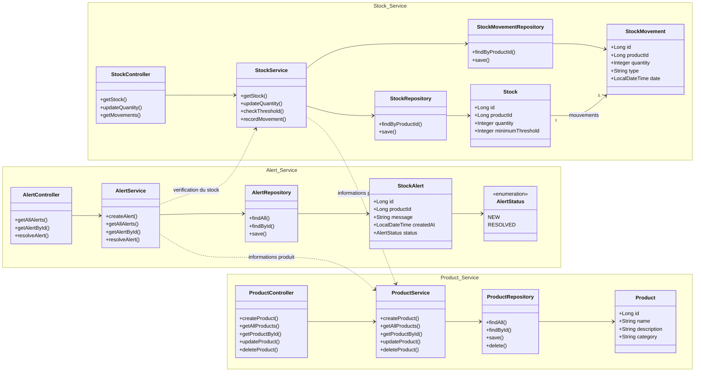
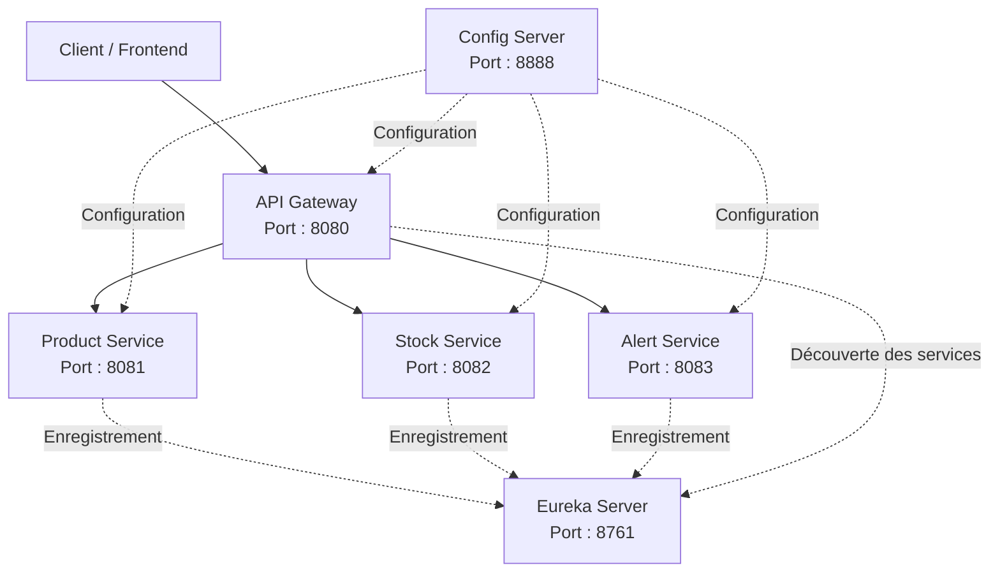

# 📦 Stock Alert — Application de gestion de stock avec microservices

## 1. Présentation du projet

**Stock Alert** est une application de gestion de stock basée sur une architecture microservices avec Spring Boot et Spring Cloud.

L'objectif est de gérer les produits, de suivre les quantités disponibles et de générer des alertes lorsque le stock d'un produit atteint ou passe sous un seuil minimal.

L'application est composée de trois services métier et de trois composants d'infrastructure :

- **Product Service** : gestion des produits.
- **Stock Service** : gestion des quantités disponibles, des seuils minimaux et des mouvements de stock.
- **Alert Service** : création et consultation des alertes de stock faible.
- **Eureka Server** : enregistrement et découverte des microservices.
- **Config Server** : centralisation de la configuration.
- **API Gateway** : point d'entrée unique et routage des requêtes vers les services métier.

## 2. Fonctionnement du projet

Le fonctionnement de l'application repose sur les étapes suivantes :

1. L'utilisateur envoie une requête via l'API Gateway pour créer, consulter ou modifier un produit.
2. Le Product Service traite les opérations relatives aux produits.
3. Le Stock Service enregistre les quantités disponibles et les seuils minimaux.
4. Lorsque la quantité en stock devient inférieure ou égale au seuil minimal, le système déclenche la création d'une alerte.
5. L'Alert Service enregistre les alertes et permet de consulter leur état.
6. Eureka Server permet aux applications de s'enregistrer et de découvrir les autres services.
7. Config Server centralise les configurations des applications.
8. L'API Gateway achemine les requêtes vers les services concernés.

**Exemple :** un produit possède une quantité disponible de 5 unités et un seuil minimal de 10 unités. Le système génère une alerte indiquant que le stock est faible.

## 3. Diagramme de classes UML global

Ce diagramme présente les principales classes des services métier, leurs relations internes et leurs dépendances entre services.

**Remarque :** ce diagramme représente la conception prévue. Les classes et les méthodes devront correspondre à l'implémentation réelle du projet. Les flèches en pointillés représentent les dépendances entre les services métier.

## 4. Schéma global de l'architecture

L'API Gateway constitue le point d'entrée des requêtes des clients. Eureka assure la découverte des services, tandis que Config Server centralise leur configuration.

## 5. Liste des applications et des ports

| Application | Port | Rôle |
|---|---:|---|
| API Gateway | 8080 | Point d'entrée unique et routage des requêtes |
| Product Service | 8081 | Gestion des produits |
| Stock Service | 8082 | Gestion du stock et des mouvements |
| Alert Service | 8083 | Gestion des alertes de stock faible |
| Eureka Server | 8761 | Enregistrement et découverte des services |
| Config Server | 8888 | Centralisation de la configuration |

Les ports proposés sont des ports locaux de développement. Ils pourront être modifiés dans les fichiers de configuration Spring Boot.

## 6. Technologies utilisées

- Java
- Spring Boot
- Spring Cloud
- Spring Cloud Netflix Eureka
- Spring Cloud Config
- Spring Cloud Gateway
- Spring Data JPA
- Base de données relationnelle
- Git et GitHub
- Mermaid pour les diagrammes

## 7. Objectifs du projet

- Comprendre les principes d'une architecture microservices.
- Séparer les responsabilités entre les services métier.
- Mettre en place la découverte des services avec Eureka.
- Centraliser la configuration avec Config Server.
- Gérer le routage avec API Gateway.
- Détecter les situations de stock faible et générer des alertes.
- Documenter l'architecture et les relations entre les services.
