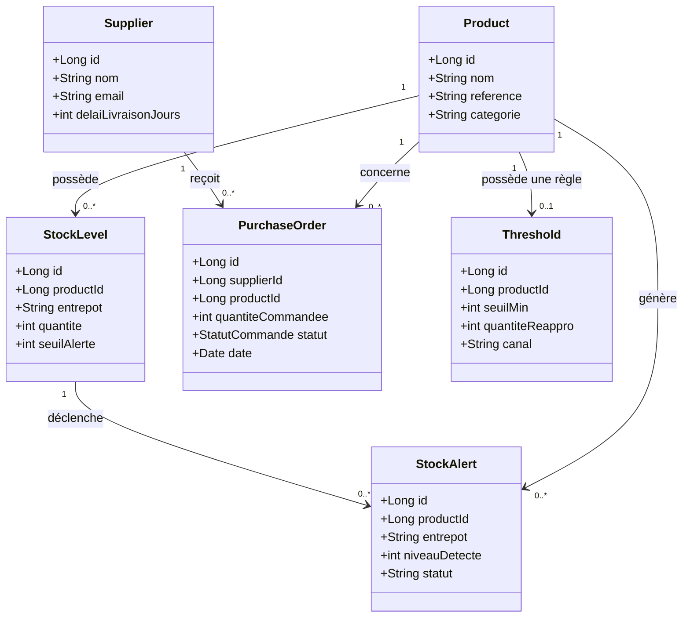
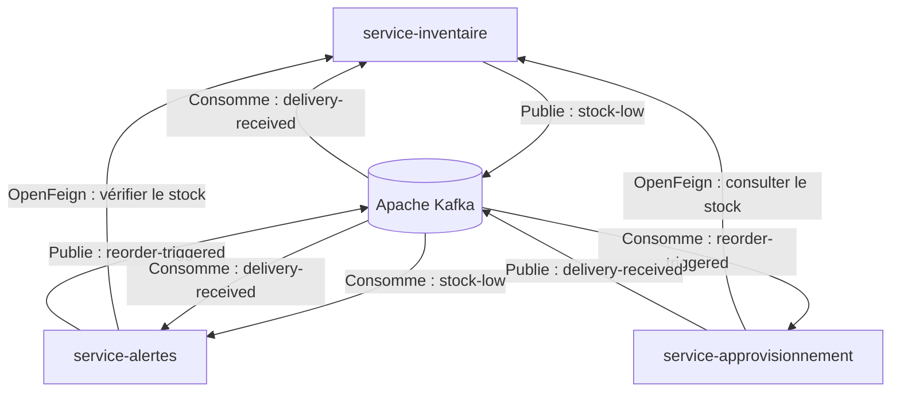

# Stock-Alert — Gestion intelligente des stocks

Application distribuée de gestion des stocks multi-entrepôts avec détection des ruptures, alertes automatiques et réapprovisionnement via des commandes d'achat.

## Présentation du projet

**Stock-Alert** vise à automatiser le cycle de réapprovisionnement. Lorsqu'une sortie de stock fait passer la quantité disponible sous un seuil défini, une alerte est créée et un processus de commande auprès d'un fournisseur est déclenché.

À la réception de la livraison, le stock est mis à jour et l'alerte correspondante est clôturée.

### Objectifs

- Gérer les produits et les stocks de plusieurs entrepôts.
- Détecter automatiquement les risques de rupture.
- Centraliser les fournisseurs et les commandes d'achat.
- Automatiser le processus de réapprovisionnement.
- Assurer la communication entre les microservices.
- Garantir le suivi du cycle de vie des commandes et des alertes.

> **Unité de traitement principale : la commande d'achat**
>
> Cycle de vie : `BROUILLON → EMISE → LIVREE`

## Architecture fonctionnelle

Le système repose sur trois microservices métier, chacun responsable d'un domaine fonctionnel distinct.

### 1. `service-inventaire`

Responsable du référentiel des produits et de la gestion des quantités par entrepôt.

| Entité | Responsabilité | Attributs principaux |
|---|---|---|
| `Product` | Référentiel des produits | `id`, `nom`, `reference`, `categorie` |
| `StockLevel` | Stock d'un produit dans un entrepôt | `id`, `productId`, `entrepot`, `quantite`, `seuilAlerte` |

### 2. `service-approvisionnement`

Service principal de gestion des fournisseurs et des commandes d'achat.

| Entité | Responsabilité | Attributs principaux |
|---|---|---|
| `Supplier` | Référentiel des fournisseurs | `id`, `nom`, `email`, `delaiLivraisonJours` |
| `PurchaseOrder` | Commande d'achat fournisseur | `id`, `supplierId`, `productId`, `quantiteCommandee`, `statut`, `date` |

Chaque commande concerne un produit, un fournisseur, une quantité et un statut.

### 3. `service-alertes`

Responsable de la définition des seuils et du suivi des ruptures de stock.

| Entité | Responsabilité | Attributs principaux |
|---|---|---|
| `Threshold` | Règle de réapprovisionnement | `id`, `productId`, `seuilMin`, `quantiteReappro`, `canal` |
| `StockAlert` | Alerte de rupture | `id`, `productId`, `entrepot`, `niveauDetecte`, `statut` |

## Diagramme de classes UML

Ce diagramme présente les principales entités métier, leurs attributs et les relations logiques entre les produits, les stocks, les fournisseurs, les commandes et les alertes.



> Les relations de ce diagramme représentent le modèle métier cible. Elles devront correspondre aux associations et aux clés étrangères réellement implémentées dans les classes Java.

## Architecture technique

L'architecture repose sur trois microservices métier qui communiquent de manière synchrone avec OpenFeign et de manière asynchrone à travers Apache Kafka.



### Rôle des microservices

- **Inventaire :** gère les produits, les stocks et la détection des seuils bas.
- **Alertes :** gère les règles de seuil, crée les alertes et déclenche le réapprovisionnement.
- **Approvisionnement :** gère les fournisseurs, les commandes d'achat et la réception des livraisons.
- **Apache Kafka :** transporte les événements métier entre les services.

## Communication entre les microservices

### Communication synchrone — OpenFeign

OpenFeign permet à un microservice d'appeler une API REST d'un autre microservice et d'obtenir une réponse immédiate.

- **Approvisionnement → Inventaire :** consulter la quantité disponible avant de déclencher une commande d'achat.
- **Alertes → Inventaire :** vérifier que le stock est sous le seuil avant de créer une alerte.

### Communication asynchrone — Apache Kafka

Kafka permet de transmettre des événements métier sans imposer un appel direct entre le producteur et le consommateur.

| Événement | Producteur | Consommateur(s) | Traitement |
|---|---|---|---|
| `stock-low` | `service-inventaire` | `service-alertes` | Créer une alerte à partir de la règle de seuil |
| `reorder-triggered` | `service-alertes` | `service-approvisionnement` | Créer et émettre une commande d'achat |
| `delivery-received` | `service-approvisionnement` | `service-inventaire`, `service-alertes` | Mettre à jour le stock et clôturer l'alerte |

## Scénario métier : du stock bas à la livraison

1. Une sortie de stock est enregistrée dans un entrepôt.
2. Le service d'inventaire détecte que la quantité passe sous le seuil d'alerte et publie l'événement `stock-low`.
3. Le service d'alertes reçoit l'événement, vérifie le stock auprès du service d'inventaire et consulte la règle `Threshold`.
4. Une `StockAlert` est créée pour le produit et l'entrepôt concernés.
5. Le service d'alertes publie `reorder-triggered` avec les informations nécessaires au réapprovisionnement.
6. Le service d'approvisionnement identifie le fournisseur et crée une `PurchaseOrder` au statut `BROUILLON`.
7. La commande est transmise au fournisseur et son statut passe à `EMISE`.
8. À la réception de la livraison, la commande passe à `LIVREE` et l'événement `delivery-received` est publié.
9. Le service d'inventaire met à jour la quantité disponible.
10. Le service d'alertes clôture l'alerte correspondante.

## Technologies

La stack technique cible comprend :

- **Langage :** Java 25
- **Framework backend :** Spring Boot
- **Communication synchrone :** Spring Cloud OpenFeign
- **Messagerie asynchrone :** Apache Kafka
- **Persistance :** Spring Data JPA
- **Base de données :** PostgreSQL
- **Gestion des dépendances :** Maven
- **Environnement de développement :** IntelliJ IDEA
- **Tests d'API :** Postman

> Cette liste correspond aux technologies envisagées pour le projet. Elle doit être ajustée selon les dépendances et les composants réellement configurés dans le dépôt.

## Structure logique cible

```text
projetstock_alert/
├── service-inventaire/
│   └── src/
├── service-approvisionnement/
│   └── src/
├── service-alertes/
│   └── src/
├── README.md
└── ...
```

Cette arborescence illustre l'organisation logique souhaitée. Les dossiers doivent correspondre à la structure réelle du dépôt.

## Tests et validation

Les tests devront couvrir les principaux scénarios métier :

- Consultation du stock par produit et par entrepôt.
- Détection d'un seuil d'alerte dépassé.
- Création et clôture d'une alerte.
- Déclenchement du réapprovisionnement.
- Création et changement d'état d'une commande d'achat.
- Réception d'une livraison et mise à jour du stock.
- Communication entre les microservices via OpenFeign.
- Publication et consommation des événements Kafka.
- Gestion des erreurs et des événements reçus plusieurs fois.

## Évolutions prévues

- Ajouter des tests unitaires et des tests d'intégration.
- Documenter les API REST avec Swagger / OpenAPI.
- Mettre en place la découverte des services avec Eureka si nécessaire.
- Centraliser la configuration avec Spring Cloud Config si nécessaire.
- Ajouter une gestion robuste des erreurs et des nouvelles tentatives Kafka.
- Prévenir les doublons lors du traitement des événements.
- Conteneuriser les microservices et leurs dépendances avec Docker Compose.
- Ajouter un tableau de bord de suivi des stocks et des alertes.

## Auteur

**Aya Jarmouni**

Projet académique — Architecture microservices et automatisation de la gestion des stocks.
