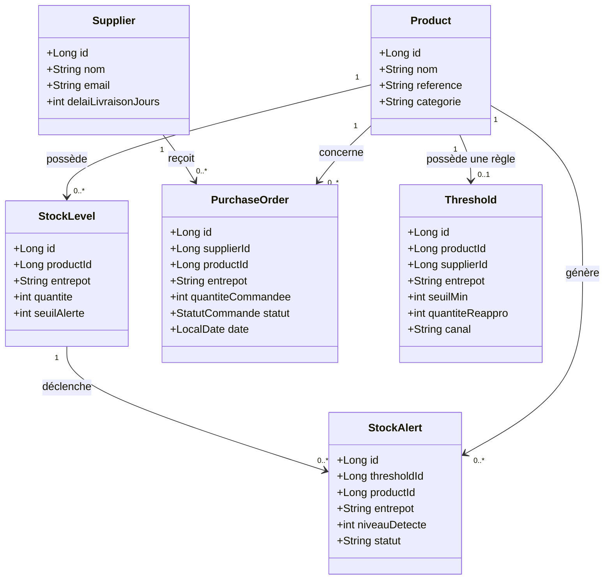
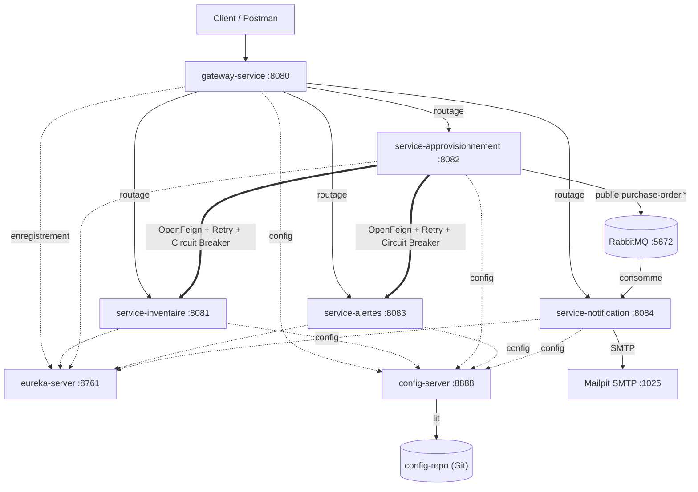
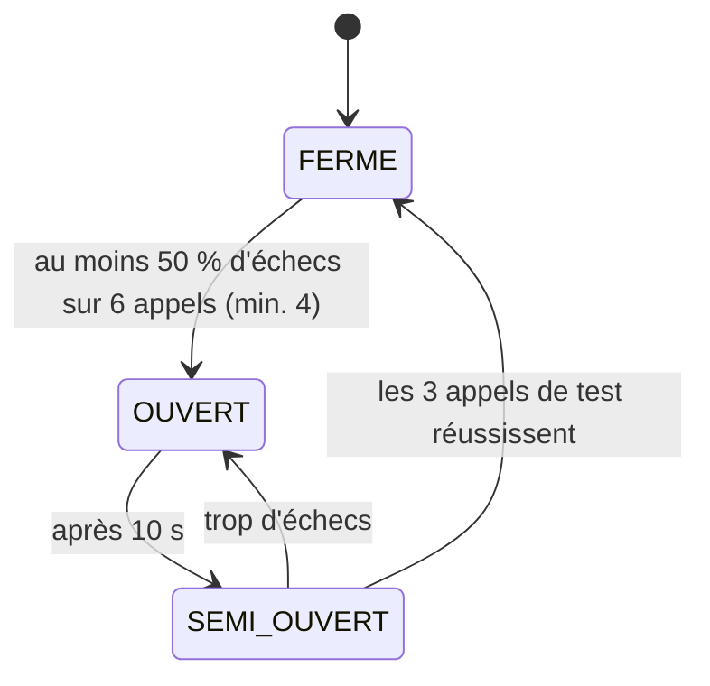

# Stock-Alert — Gestion intelligente des stocks

Application distribuée de gestion des stocks multi-entrepôts avec détection des ruptures, alertes et réapprovisionnement via des commandes d'achat. Elle est construite en **microservices Spring Boot / Spring Cloud**.

## Sommaire

1. [Présentation du projet](#présentation-du-projet)
2. [État d'avancement](#état-davancement)
3. [Architecture fonctionnelle](#architecture-fonctionnelle)
4. [Architecture technique](#architecture-technique)
5. [Technologies](#technologies)
6. [Structure du dépôt](#structure-du-dépôt)
7. [Démarrage rapide](#démarrage-rapide)
8. [API REST](#api-rest)
9. [Jalons](#jalons) : [V1](#jalon-v1--services-métier-indépendants) · [V2](#jalon-v2--infrastructure-spring-cloud-eureka--gateway) · [V3](#jalon-v3--centralisation-des-configurations-spring-cloud-config) · [V4](#jalon-v4--communication-entre-microservices-openfeign) · [V5](#jalon-v5--notifications-par-email-rabbitmq--mailpit) · [V6](#jalon-v6--résilience-resilience4j)
10. [Tests](#tests)
11. [Limites connues et évolutions](#limites-connues-et-évolutions)
12. [Auteur](#auteur)

## Présentation du projet

**Stock-Alert** vise à automatiser le cycle de réapprovisionnement. Lorsque le stock d'un produit passe sous un seuil défini, une alerte est créée et un processus de commande auprès d'un fournisseur est déclenché. À la réception de la livraison, le stock est mis à jour et l'alerte est clôturée.

### Objectifs

- Gérer les produits et les stocks de plusieurs entrepôts.
- Détecter les risques de rupture grâce à des seuils.
- Centraliser les fournisseurs et les commandes d'achat.
- Faire communiquer les microservices de façon synchrone (OpenFeign) et asynchrone (RabbitMQ).
- Rendre les appels entre services fiables (idempotence, délais, nouvelles tentatives, disjoncteur).
- Suivre le cycle de vie des commandes et des alertes.

> **Unité de traitement principale : la commande d'achat** (`PurchaseOrder`)
>
> Cycle de vie : `BROUILLON → EMISE → LIVREE`

## État d'avancement

| Jalon | Contenu | État |
|---|---|---|
| V1 | Trois services métier indépendants (inventaire, approvisionnement, alertes) | Fait |
| V2 | Eureka (registre) + API Gateway | Fait |
| V3 | Spring Cloud Config (configuration centralisée dans `config-repo/`) | Fait |
| V4 | Communication synchrone OpenFeign, création contrôlée, idempotence | Fait |
| V5 | Notifications email par RabbitMQ + Mailpit (`service-notification`) | Fait |
| V6 | Résilience : Retry + Circuit Breaker (Resilience4j) sur les appels Feign | Fait (configuration et code) |
| Suite | Événements métier Kafka (`stock-low`, `reorder-triggered`, `delivery-received`), appel Alertes → Inventaire | **Non implémenté** (voir [Limites](#limites-connues-et-évolutions)) |

## Architecture fonctionnelle

Trois microservices métier, chacun responsable d'un domaine, plus un service de notification.

### 1. `service-inventaire` (port 8081)

Référentiel des produits et quantités par entrepôt.

| Entité | Responsabilité | Attributs principaux |
|---|---|---|
| `Product` | Référentiel des produits | `id`, `nom`, `reference`, `categorie` |
| `StockLevel` | Stock d'un produit dans un entrepôt | `id`, `productId`, `entrepot`, `quantite`, `seuilAlerte` |

### 2. `service-approvisionnement` (port 8082)

Gestion des fournisseurs et des commandes d'achat. C'est le service qui appelle les autres (Feign) et qui publie les événements de notification (RabbitMQ).

| Entité | Responsabilité | Attributs principaux |
|---|---|---|
| `Supplier` | Référentiel des fournisseurs | `id`, `nom`, `email`, `delaiLivraisonJours` |
| `PurchaseOrder` | Commande d'achat fournisseur | `id`, `supplierId`, `productId`, `entrepot`, `quantiteCommandee`, `statut`, `date` |
| `IdempotencyRecord` | Clé d'idempotence (V4) | clé unique, empreinte SHA-256 du contenu, commande associée |

### 3. `service-alertes` (port 8083)

Définition des seuils et suivi des ruptures.

| Entité | Responsabilité | Attributs principaux |
|---|---|---|
| `Threshold` | Règle de réapprovisionnement | `id`, `productId`, `supplierId`, `entrepot`, `seuilMin`, `quantiteReappro`, `canal` |
| `StockAlert` | Alerte de rupture | `id`, `thresholdId`, `productId`, `entrepot`, `niveauDetecte`, `statut` (`OUVERTE` / `CLOTUREE`) |

### 4. `service-notification` (port 8084, V5)

Consomme les événements RabbitMQ, envoie les emails aux fournisseurs et garde l'historique (`NotificationLog`, `eventId` unique).

### Diagramme de classes UML



> Les références entre services (`productId`, `supplierId`, `thresholdId`) sont de simples `Long` sans clé étrangère : chaque service reste autonome et possède sa propre base. Seules les relations à l'intérieur d'un même service sont de vraies associations JPA.

## Architecture technique

Architecture **telle qu'implémentée** (V6) :



### Communication entre microservices

**Synchrone — OpenFeign (implémenté, V4 + V6)**

- Approvisionnement → Inventaire : vérifier l'existence du produit et du stock dans l'entrepôt avant d'enregistrer une commande.
- Approvisionnement → Alertes : enrichir la consultation d'une commande avec l'alerte ouverte.
- Alertes → Inventaire : vérifier le stock avant de créer une alerte (*à venir*, pas encore de client Feign dans `service-alertes`).

**Asynchrone — RabbitMQ (implémenté, V5)**

| Événement (clé de routage) | Producteur | Consommateur | Traitement |
|---|---|---|---|
| `purchase-order.emise` | `service-approvisionnement` | `service-notification` | Email « commande émise » au fournisseur |
| `purchase-order.livree` | `service-approvisionnement` | `service-notification` | Email « commande livrée » au fournisseur |

### Architecture cible (non implémentée) : événements métier Kafka

Le cahier des charges prévoit à terme un bus d'événements Kafka entre les trois services métier. Le code ne contient que des commentaires `Jalon suivant` à ces endroits.

| Événement | Producteur | Consommateur(s) | Traitement prévu |
|---|---|---|---|
| `stock-low` | `service-inventaire` | `service-alertes` | Créer une alerte à partir de la règle de seuil |
| `reorder-triggered` | `service-alertes` | `service-approvisionnement` | Créer et émettre une commande d'achat |
| `delivery-received` | `service-approvisionnement` | `service-inventaire`, `service-alertes` | Mettre à jour le stock et clôturer l'alerte |

Scénario cible : sortie de stock → seuil franchi → `stock-low` → alerte → `reorder-triggered` → commande `BROUILLON` → `EMISE` → livraison → `delivery-received` → stock mis à jour et alerte clôturée. Aujourd'hui, ces étapes se font manuellement via l'API (création d'alerte, création et émission de commande, livraison).

## Technologies

| Domaine | Technologie |
|---|---|
| Langage | Java 17 |
| Framework | Spring Boot 3.5.6 (Web, Validation, Data JPA, Actuator, AOP) |
| Spring Cloud | 2025.0.0 : Eureka (registre), Gateway WebFlux, Config Server, OpenFeign |
| Résilience | Resilience4j (Retry, Circuit Breaker) via Spring Cloud CircuitBreaker |
| Messagerie | RabbitMQ 3.13 (Spring AMQP) |
| Emails | Spring Mail + Mailpit (faux serveur SMTP de développement) |
| Persistance | Spring Data JPA, H2 en mémoire (une base par service) |
| Mapping | MapStruct (entité ↔ DTO) |
| Documentation d'API | springdoc-openapi (Swagger UI) |
| Conteneurs | Docker Compose (RabbitMQ, Mailpit) |
| Build | Maven (wrapper `mvnw` fourni) |
| Tests | JUnit 5, Mockito, Postman / Newman |
| Environnement | IntelliJ IDEA |

## Structure du dépôt

```text
projetstock_alert/
├── pom.xml                      # POM agrégateur (7 modules)
├── service-inventaire/          # port 8081 — Product, StockLevel
├── service-approvisionnement/   # port 8082 — Supplier, PurchaseOrder (Feign, Resilience4j, producteur RabbitMQ)
├── service-alertes/             # port 8083 — Threshold, StockAlert
├── service-notification/        # port 8084 — consommateur RabbitMQ, envoi d'emails
├── eureka-server/               # port 8761 — registre de services
├── gateway-service/             # port 8080 — API Gateway
├── config-server/               # port 8888 — serveur de configuration
├── config-repo/                 # fichiers de configuration servis par le Config Server
├── docker-compose.yml           # RabbitMQ + Mailpit
├── docs/                        # schémas (.mmd + .png) et tests Postman documentés
├── postman/                     # collections Postman (V1, V4, V5) et scripts Newman
└── README.md
```

Chaque service métier suit la même organisation en couches :

```text
com.stockalert.<service>/
├── controller/   # API REST (codes HTTP, @Valid)
├── service/      # règles métier, transactions
├── repository/   # Spring Data JPA
├── entite/       # entités JPA
├── dto/          # DTO validés (Jakarta Validation)
├── mapper/       # MapStruct entité <-> DTO
└── exception/    # exceptions métier + @RestControllerAdvice
```

## Démarrage rapide

### Prérequis

- JDK 17 ou supérieur
- Docker (pour RabbitMQ et Mailpit)
- Maven, ou le wrapper `mvnw` / `mvnw.cmd` fourni
- Accès à GitHub : le Config Server lit les **commits** du dépôt configuré (voir ci-dessous)

### 1. Compiler

```bash
./mvnw clean verify          # Linux / macOS
.\mvnw.cmd clean verify      # Windows (PowerShell)
```

### 2. Lancer l'infrastructure Docker

```bash
docker compose up -d         # RabbitMQ + Mailpit
docker compose ps            # état (healthy)
```

### 3. Lancer les services, dans cet ordre

| # | Module | Commande |
|---|---|---|
| 1 | Eureka | `./mvnw -pl eureka-server spring-boot:run` |
| 2 | Config Server | `./mvnw -pl config-server spring-boot:run` |
| 3 | Services métier | `./mvnw -pl service-inventaire spring-boot:run`, puis `service-alertes`, `service-approvisionnement`, `service-notification` |
| 4 | Gateway | `./mvnw -pl gateway-service spring-boot:run` |

Dans IntelliJ : ouvrir le `pom.xml` racine (*Load Maven Project*) et lancer chaque classe `...Application` (une configuration d'exécution par module).

> **Config Server et Git.** Le Config Server clone le dépôt défini dans `config-server/src/main/resources/application.properties` (`spring.cloud.config.server.git.uri`, branche `main`, dossier `config-repo`). Il lit les **commits**, pas votre dossier de travail : après toute modification de `config-repo/`, faites un `git commit` + `git push` avant de relancer les services. Sans Config Server, les services refusent de démarrer (*fail-fast*). Pour travailler hors ligne, adaptez l'URI vers un chemin local.

### Ports et interfaces

| Composant | Port | Interface |
|---|---|---|
| gateway-service | 8080 | routage vers tous les services |
| service-inventaire | 8081 | [Swagger](http://localhost:8081/swagger-ui/index.html) · [H2](http://localhost:8081/h2-console) (`jdbc:h2:mem:inventairedb`, user `sa`) |
| service-approvisionnement | 8082 | [Swagger](http://localhost:8082/swagger-ui/index.html) · [H2](http://localhost:8082/h2-console) (`jdbc:h2:mem:approvisionnementdb`) |
| service-alertes | 8083 | [Swagger](http://localhost:8083/swagger-ui/index.html) · [H2](http://localhost:8083/h2-console) (`jdbc:h2:mem:alertesdb`) |
| service-notification | 8084 | [Swagger](http://localhost:8084/swagger-ui/index.html) · [H2](http://localhost:8084/h2-console) (`jdbc:h2:mem:notificationdb`) |
| eureka-server | 8761 | [Dashboard Eureka](http://localhost:8761) |
| config-server | 8888 | ex. http://localhost:8888/service-inventaire/default |
| RabbitMQ | 5672 / 15672 | [Console](http://localhost:15672) (`stockalert` / `stockalert`) |
| Mailpit | 1025 / 8025 | [Boîte de réception](http://localhost:8025) |

Les bases H2 sont recréées et alimentées par `data.sql` à chaque démarrage.

## API REST

Les URL ci-dessous sont celles des services. Par la Gateway (routage dynamique par défaut), préfixer par le nom du service : `http://localhost:8080/service-inventaire/products` (voir [V2](#jalon-v2--infrastructure-spring-cloud-eureka--gateway)).

**service-inventaire**

| Méthode | URL | Description | Codes |
|---|---|---|---|
| GET / POST | `/products` | Lister / créer un produit | 200 / 201, 400, 409 (référence en double) |
| GET / PUT / DELETE | `/products/{id}` | Consulter / modifier / supprimer | 200, 204, 400, 404, 409 (stock rattaché) |
| GET / POST | `/stock-levels` | Lister (`?productId=&entrepot=`) / créer | 200 / 201, 400, 404 (produit), 409 (doublon produit+entrepôt) |
| GET / PUT / DELETE | `/stock-levels/{id}` | Consulter / modifier / supprimer | 200, 204, 400, 404, 409 |
| POST | `/stock-levels/{id}/sortie` | Sortie de stock `{"quantite": n}` | 200, 400, 404, 409 (stock insuffisant) |
| POST | `/stock-levels/{id}/entree` | Entrée de stock `{"quantite": n}` | 200, 400, 404 |

**service-approvisionnement**

| Méthode | URL | Description | Codes |
|---|---|---|---|
| GET / POST | `/suppliers` | Lister / créer un fournisseur | 200 / 201, 400 |
| GET / PUT / DELETE | `/suppliers/{id}` | Consulter / modifier / supprimer | 200, 204, 400, 404, 409 (commandes rattachées) |
| GET | `/purchase-orders` | Lister (`?statut=&supplierId=`), sans enrichissement | 200 |
| POST | `/purchase-orders` | Créer (statut `BROUILLON`), en-tête `Idempotency-Key` obligatoire | 201, 200 (rejeu), 400, 404, 409, 502, 503 |
| GET | `/purchase-orders/{id}` | Consulter, **enrichi** (fournisseur, produit, stock, alerte ouverte) | 200, 404 |
| PUT / DELETE | `/purchase-orders/{id}` | Modifier / supprimer (`BROUILLON` seulement) | 200, 204, 400, 404, 409, 502, 503 |
| POST | `/purchase-orders/{id}/emettre` | `BROUILLON` → `EMISE` (publie l'événement email) | 200, 404, 409 |
| POST | `/purchase-orders/{id}/livrer` | `EMISE` → `LIVREE` (publie l'événement email) | 200, 404, 409 |

**service-alertes**

| Méthode | URL | Description | Codes |
|---|---|---|---|
| GET / POST | `/thresholds` | Lister / créer une règle de seuil | 200 / 201, 400, 409 (doublon produit+entrepôt) |
| GET / PUT / DELETE | `/thresholds/{id}` | Consulter / modifier / supprimer | 200, 204, 400, 404, 409 (alertes rattachées) |
| GET / POST | `/stock-alerts` | Lister (`?statut=&productId=`) / créer une alerte `OUVERTE` | 200 / 201, 400, 404 (règle), 409 (alerte ouverte existante) |
| GET / DELETE | `/stock-alerts/{id}` | Consulter / supprimer | 200, 204, 404 |
| POST | `/stock-alerts/{id}/cloturer` | `OUVERTE` → `CLOTUREE` | 200, 404, 409 |

**service-notification**

| Méthode | URL | Description | Codes |
|---|---|---|---|
| GET | `/notifications` | Historique des emails traités | 200 |
| GET | `/notifications/{id}` | Détail d'une notification | 200, 404 |

### Format des erreurs

Toutes les erreurs renvoient le même corps JSON :

```json
{
  "timestamp": "2026-11-18T22:10:31.512",
  "status": 400,
  "erreur": "Bad Request",
  "message": "Données de la requête invalides",
  "chemin": "/products",
  "details": ["nom : Le nom est obligatoire", "reference : La référence est obligatoire"]
}
```

| Code | Cas |
|---|---|
| 400 | Validation du DTO, JSON mal formé, énumération ou identifiant de type incorrect, en-tête `Idempotency-Key` absent |
| 404 | Ressource inexistante (y compris produit/fournisseur/règle référencé, local ou distant) |
| 409 | Conflit métier : doublon, transition de statut interdite, stock insuffisant, stock suffisant (pas de réapprovisionnement), clé d'idempotence réutilisée avec un autre contenu, suppression d'une ressource encore utilisée |
| 502 | Réponse inattendue d'un service distant (contrat incompatible) |
| 503 | Service distant indisponible, délai dépassé ou disjoncteur ouvert |

## Jalons

### Jalon V1 — Services métier indépendants

Trois services opérationnels (Controller / Service / Repository), DTO validés, API REST avec codes HTTP adaptés, gestion centralisée des erreurs, données propres à chaque service. Aucun appel entre services à ce stade.

Choix de conception :

- Les références entre services sont de simples `Long` sans clé étrangère (autonomie des services).
- Une `PurchaseOrder` naît toujours en `BROUILLON` (date du jour) ; seul un brouillon peut être modifié ou supprimé.
- Une `StockAlert` reprend `productId` et `entrepot` de sa règle `Threshold` ; le niveau détecté doit être inférieur à `seuilMin`, et une seule alerte `OUVERTE` est admise par règle.
- La livraison d'une commande (`livrer`) ne met **pas** le stock à jour et ne clôture pas l'alerte : ce lien est prévu avec l'événement `delivery-received`, non implémenté.

### Jalon V2 — Infrastructure Spring Cloud (Eureka + Gateway)

| Module | Port | Rôle |
|---|---|---|
| eureka-server | 8761 | Registre de services (`service-registry`) |
| gateway-service | 8080 | API Gateway réactive (Spring Cloud Gateway WebFlux) |

Tous les services s'enregistrent auprès d'Eureka.

**Routage dynamique (profil par défaut).** Le *discovery locator* crée les routes à partir des services découverts :

- http://localhost:8080/service-inventaire/products
- http://localhost:8080/service-inventaire/stock-levels
- http://localhost:8080/service-approvisionnement/suppliers
- http://localhost:8080/service-approvisionnement/purchase-orders
- http://localhost:8080/service-alertes/thresholds
- http://localhost:8080/service-alertes/stock-alerts
- http://localhost:8080/service-notification/notifications

Un nouveau service qui rejoint Eureka devient accessible sans modifier ni redémarrer la Gateway.

**Routage statique (profil `statique`).** Lancer la Gateway avec `-Dspring.profiles.active=statique`. Les chemins sont alors exposés sans préfixe : `/products/**`, `/stock-levels/**`, `/suppliers/**`, `/purchase-orders/**`, `/thresholds/**`, `/stock-alerts/**`, `/notifications/**` (`lb://` + Eureka).

### Jalon V3 — Centralisation des configurations (Spring Cloud Config)

Les configurations sont externalisées dans `config-repo/` (versionné sur Git) et servies par `config-server` (port 8888).

| Fichier de `config-repo/` | Contenu |
|---|---|
| `application.properties` | Commun à tous : URL Eureka, exposition Actuator (`health`, `info`) |
| `service-inventaire.properties` | Port 8081, H2, JPA, jeu de données |
| `service-approvisionnement.properties` | Port 8082, H2, JPA, Feign (V4), RabbitMQ (V5), Resilience4j (V6) |
| `service-alertes.properties` | Port 8083, H2, JPA, jeu de données |
| `service-notification.properties` | Port 8084, H2, RabbitMQ (consommateur, tentatives), SMTP (V5) |
| `gateway-service.properties` | Port 8080, routage dynamique |

Eureka et le Config Server restent en configuration locale (problème d'amorçage). Chaque autre service ne contient plus que :

```properties
spring.application.name=<nom-du-service>
spring.config.import=configserver:http://localhost:8888
```

Vérification : `http://localhost:8888/<nom-du-service>/default`, puis les instances `UP` dans Eureka.

### Jalon V4 — Communication entre microservices (OpenFeign)

L'opération métier concernée est la **création d'une commande d'achat**. Elle référence des ressources d'autres services (`productId`, `entrepot` → inventaire ; alerte liée → alertes). Le jalon ajoute :

- des **clients OpenFeign** (`InventaireClient`, `AlertesClient`) résolus par nom via Eureka ;
- une **création contrôlée** : vérification du produit, du stock dans l'entrepôt et de la règle métier avant l'enregistrement ;
- une **consultation enrichie** de `GET /purchase-orders/{id}` ;
- une gestion des **ressources introuvables, refus métier et erreurs de communication** ;
- une **clé d'idempotence** (`Idempotency-Key`) contre les doubles créations.


Les sources des schémas sont dans `docs/*.mmd` (exports PNG à côté).

#### Création contrôlée

`POST /purchase-orders` — en-tête **`Idempotency-Key` obligatoire** (≤ 100 caractères, par exemple un UUID).


| # | Contrôle | Où | Échec |
|---|---|---|---|
| 1 | Corps valide (`@Valid`) et en-tête `Idempotency-Key` présent | local | 400 |
| 2 | Clé d'idempotence déjà connue ? | local | 200 (rejeu) ou 409 (contenu différent) |
| 3 | Le fournisseur existe | base locale | 404 |
| 4 | Le produit existe | Feign → `service-inventaire` `GET /products/{id}` | 404 (ou 503) |
| 5 | Un stock existe pour ce produit dans cet entrepôt | Feign → `GET /stock-levels?productId=&entrepot=` | 404 (ou 503) |
| 6 | **Règle métier** : on ne réapprovisionne que si `quantité ≤ seuilAlerte` | données du stock | 409 « Réapprovisionnement refusé : stock suffisant » |

La commande est ensuite créée au statut `BROUILLON` et la clé est mémorisée **dans la même transaction**. `PUT /purchase-orders/{id}` applique les mêmes contrôles 3 à 6. Les appels distants se font hors transaction base de données.

#### Idempotence

| Situation | Résultat |
|---|---|
| Nouvelle clé | `201 Created` + `Location` |
| Même clé, **même contenu** (rejeu) | `200 OK` + en-tête `Idempotent-Replayed: true`, la commande d'origine est renvoyée |
| Même clé, **contenu différent** | `409 Conflict` |
| Clé absente / vide / > 100 caractères | `400 Bad Request` |
| Création refusée (404, 409, 503) | rien n'est enregistré, la clé reste utilisable |
| Brouillon supprimé | sa clé est libérée |

Mise en œuvre : table `idempotency_record` avec **contrainte d'unicité sur la clé** et empreinte SHA-256 du contenu (fournisseur, produit, entrepôt, quantité). Si deux requêtes identiques arrivent simultanément, la contrainte fait échouer la seconde, qui renvoie la commande de la première.

#### Consultation enrichie


```json
{
  "id": 1, "supplierId": 1, "productId": 1, "entrepot": "Rabat",
  "quantiteCommandee": 30, "statut": "BROUILLON", "date": "2026-11-10",
  "fournisseur":   { "id": 1, "nom": "TechDistrib Maroc", "email": "commandes@techdistrib.ma", "delaiLivraisonJours": 3 },
  "produit":       { "id": 1, "nom": "Ordinateur portable Dell Latitude 5440", "reference": "DELL-LAT-5440", "categorie": "Informatique" },
  "stock":         { "id": 2, "productId": 1, "entrepot": "Rabat", "quantite": 8, "seuilAlerte": 10 },
  "alerteOuverte": { "id": 1, "thresholdId": 1, "productId": 1, "entrepot": "Rabat", "niveauDetecte": 8, "statut": "OUVERTE" },
  "avertissements": []
}
```

La liste `GET /purchase-orders` reste non enrichie (évite N appels distants).

#### Gestion des erreurs de communication

| Cause | Détection | Code |
|---|---|---|
| Ressource inexistante chez un autre service | `FeignErreurDecoder` : réponse 404 | 404 |
| Refus métier (stock suffisant, clé réutilisée) | règle locale | 409 |
| Service distant arrêté, aucune instance Eureka, délai dépassé, réponse 5xx | exception Feign | 503 |
| Réponse 4xx inattendue du service distant | `FeignErreurDecoder` | 502 |

- **Création** : si un contrôle ne peut pas être fait, la commande n'est **pas** enregistrée.
- **Consultation** : un service distant en erreur **ne bloque pas** la lecture. La commande locale est renvoyée avec `200`, le bloc concerné vaut `null` et la cause est listée dans `avertissements`.
- Délais Feign : `connect-timeout=2000 ms`, `read-timeout=3000 ms`. Les nouvelles tentatives sont gérées depuis la V6 par Resilience4j (le `Retryer` Feign est désactivé).
- Chaque appel Feign est journalisé (service, opération, durée).

#### Choix de conception

- Règle simple et vérifiable : une commande d'achat n'a de sens que si le stock est **à ou sous** son seuil d'alerte.
- Idempotence en base (et non en mémoire) pour survivre à plusieurs instances et aux requêtes concurrentes.
- Consultation tolérante aux pannes, création stricte.

### Jalon V5 — Notifications par email (RabbitMQ + Mailpit)

**Opération métier notifiée :** le changement d'état d'une commande d'achat.

| Opération validée | Événement RabbitMQ | Email envoyé au fournisseur |
|---|---|---|
| `POST /purchase-orders/{id}/emettre` (`BROUILLON` → `EMISE`) | `purchase-order.emise` | « Commande d'achat n°N émise » : produit, quantité, entrepôt, délai convenu |
| `POST /purchase-orders/{id}/livrer` (`EMISE` → `LIVREE`) | `purchase-order.livree` | « Commande d'achat n°N livrée » : accusé de réception |

Le destinataire est `Supplier.email`. Une opération refusée (409, 404) ne produit ni événement ni email.


| Composant | Port | Rôle |
|---|---|---|
| service-approvisionnement | 8082 | **Producteur** : publie l'événement après le commit |
| RabbitMQ | 5672 / 15672 | Broker : échange `stockalert.events`, file `notification.purchase-order`, DLQ |
| service-notification | 8084 | **Consommateur** : construit et envoie l'email, garde l'historique |
| Mailpit | 1025 / 8025 | Faux serveur SMTP : capture les emails sans les envoyer |

#### Déclenchement : après le commit, sans attendre l'email

1. `PurchaseOrderService.emettre/livrer` change le statut dans une transaction et publie un **événement Spring interne** (`CommandeEvenement`).
2. `CommandeEvenementPublisher` est un `@TransactionalEventListener(phase = AFTER_COMMIT)` **asynchrone** (`@Async`) : l'événement n'est envoyé à RabbitMQ qu'une fois la transaction validée.
3. La réponse HTTP est renvoyée sans attendre RabbitMQ ni l'envoi de l'email.

#### Contrat JSON de l'événement

Échange `stockalert.events` (topic, durable), clés `purchase-order.emise` / `purchase-order.livree`, messages persistants, `messageId` = `eventId`.

```json
{
  "eventId": "0b8f6c1e-5a1d-4a0e-9d9b-2f5c5f0c1a11",
  "type": "PURCHASE_ORDER_EMISE",
  "occurredAt": "2026-11-21T00:41:07.512Z",
  "purchaseOrderId": 4,
  "statut": "EMISE",
  "date": "2026-11-21",
  "supplierId": 1,
  "supplierNom": "TechDistrib Maroc",
  "supplierEmail": "commandes@techdistrib.ma",
  "delaiLivraisonJours": 3,
  "productId": 1,
  "produitNom": "Ordinateur portable Dell Latitude 5440",
  "entrepot": "Rabat",
  "quantiteCommandee": 30
}
```

`produitNom` est ajouté si `service-inventaire` répond ; sinon l'email indique « Produit n°1 ».

#### Fiabilité et gestion des erreurs

| Situation | Comportement |
|---|---|
| Consommateur arrêté | Les messages restent dans la file durable ; ils sont traités au redémarrage. L'API répond normalement. |
| Mailpit / SMTP arrêté | **4 essais** (1 s, 2 s, 4 s) puis rejet vers la file `notification.purchase-order.dlq` (échange `stockalert.events.dlx`). |
| Message invalide (JSON illisible, email absent, type inconnu) | Rejet sans remise en file → DLQ. |
| Même événement reçu deux fois | `eventId` unique : un seul email, le doublon est ignoré. |
| RabbitMQ arrêté lors de l'émission | La commande est enregistrée et l'API répond `200` ; la publication échoue et est journalisée (voir limites). |

#### Commandes Docker utiles

```bash
docker compose up -d          # démarre RabbitMQ et Mailpit
docker compose logs -f rabbitmq mailpit
docker compose stop mailpit   # simuler une panne SMTP (docker compose start mailpit pour relancer)
docker compose stop rabbitmq  # simuler une panne du broker
docker compose down           # arrête les conteneurs (files durables conservées)
docker compose down -v        # idem + supprime le volume
```

#### Parcours complet (PowerShell, ou Postman)

```powershell
# a) Créer une commande (stock Rabat produit 1 : 8 <= seuil 10) -> 201 BROUILLON (noter l'id)
curl.exe -i -X POST http://localhost:8082/purchase-orders -H "Content-Type: application/json" -H "Idempotency-Key: demo-001" -d '{\"supplierId\":1,\"productId\":1,\"entrepot\":\"Rabat\",\"quantiteCommandee\":30}'
# b) L'émettre -> 200 EMISE immédiatement ; l'email part ensuite
curl.exe -i -X POST http://localhost:8082/purchase-orders/4/emettre
# c) Voir l'email dans Mailpit : http://localhost:8025  (ou via l'API)
curl.exe http://localhost:8025/api/v1/messages
# d) Historique côté consommateur
curl.exe http://localhost:8084/notifications
```

Autres scénarios : arrêter `service-notification`, émettre une commande (`200`) et constater dans la console RabbitMQ 1 message prêt, 0 consommateur, puis redémarrer le service (la file se vide, l'email apparaît) ; ou arrêter Mailpit pour provoquer le passage en DLQ.

#### Choix de conception et limites

- Après le commit, hors requête : pas d'email pour une transaction annulée, aucune latence ajoutée à l'API.
- File déclarée des deux côtés : aucun message perdu avant le premier démarrage du consommateur.
- Une seule file pour les deux types d'événements (clé `purchase-order.*`).
- **Limite connue :** si RabbitMQ est arrêté au moment de l'émission, la notification est perdue (la commande reste valide). La solution complète est le patron *transactional outbox*, non implémenté.
- Pas de Dockerfile pour les microservices : seuls RabbitMQ et Mailpit sont conteneurisés.

### Jalon V6 — Résilience (Resilience4j)

Le jalon V6 protège `service-approvisionnement` contre les pannes et lenteurs de `service-inventaire` et `service-alertes`. Les trois appels Feign (`produit`, `stocks`, `alertesOuvertes`) sont regroupés dans `ServicesDistantsGateway` et décorés par deux annotations :

```java
@Retry(name = "inventaire", fallbackMethod = "repliProduit")
@CircuitBreaker(name = "inventaire")
public ProduitDistantDto produit(Long productId) { ... }
```

Deux instances de configuration existent : `inventaire` (produit et stocks) et `alertes` (alertes ouvertes). Les paramètres sont dans `config-repo/service-approvisionnement.properties`.

#### Retry

| Paramètre | Valeur |
|---|---|
| Tentatives maximum | 3 |
| Attente entre deux tentatives | 500 ms |
| Exceptions qui déclenchent une nouvelle tentative | `ServiceDistantIndisponibleException` uniquement |

Un 404 ou une réponse inattendue du service distant n'est donc **jamais** rejoué. Les appels étant des `GET`, ils sont rejouables sans risque. Le `Retryer` de Feign est désactivé (`Retryer.NEVER_RETRY`) : Resilience4j est la seule source de nouvelles tentatives.

#### Circuit Breaker

| Paramètre | Valeur |
|---|---|
| Fenêtre glissante | 6 appels (`COUNT_BASED`) |
| Appels minimum avant évaluation | 4 |
| Seuil d'échec | 50 % |
| Durée en état ouvert | 10 s |
| Appels de test en état semi-ouvert | 3 |
| Passage automatique ouvert → semi-ouvert | activé |
| Exceptions **ignorées** (ne comptent pas comme échec) | `RessourceDistanteIntrouvableException`, `ReponseDistanteInattendueException` |



Ordre des protections : `retry-aspect-order=1` et `circuit-breaker-aspect-order=2`. Le Retry enveloppe donc le Circuit Breaker : chaque tentative passe par le disjoncteur et est comptée dans sa fenêtre.

#### Replis (fallbacks)

Chaque appel a une méthode de repli (`repliProduit`, `repliStocks`, `repliAlertes`) qui traduit l'échec en exception métier :

| Cause | Résultat côté API |
|---|---|
| Erreur métier distante (404, réponse inattendue) | exception d'origine conservée → 404 ou 502 |
| Disjoncteur ouvert (`CallNotPermittedException`) | `ServiceDistantIndisponibleException` « Circuit Breaker ouvert », avec un avertissement dans les logs → **503** immédiat, sans appel réseau |
| Erreur de communication (service arrêté, délai dépassé, 5xx) après les tentatives | `ServiceDistantIndisponibleException` → **503** |

Comme en V4, la **consultation** `GET /purchase-orders/{id}` reste tolérante (bloc `null` + `avertissements`), alors que la **création** est refusée (503) si un contrôle ne peut pas être fait.

> Au pire, un appel vers un service muet peut durer environ 10 s (3 tentatives × délai de lecture de 3 s, plus 2 pauses de 500 ms) avant de répondre 503. Si le disjoncteur est ouvert, la réponse est immédiate.

#### Tester le comportement

1. Démarrer toute la plateforme et vérifier qu'une création de commande répond `201`.
2. Arrêter `service-inventaire`.
3. Envoyer plusieurs créations avec des clés `Idempotency-Key` différentes : `503` après les tentatives, puis, une fois le seuil franchi, `503` immédiat « Circuit Breaker ouvert ».
4. Redémarrer `service-inventaire`, attendre 10 s : le disjoncteur passe en semi-ouvert, puis se referme après 3 appels réussis.

> Les états du disjoncteur ne sont pas exposés : `management.endpoints.web.exposure.include` ne contient que `health,info`. Pour les observer, ajouter `circuitbreakers,retries` à cette liste dans `config-repo/application.properties` (puis commit + push). Aucune collection Postman ni schéma dédié à la V6 n'est encore présent dans le dépôt, et aucun test automatisé ne couvre ce jalon.

## Tests

### Tests unitaires (Mockito, sans démarrer les services)

| Classe | Module | Tests |
|---|---|---|
| `ControleCommandeServiceTest` | service-approvisionnement | 6 |
| `PurchaseOrderServiceTest` | service-approvisionnement | 9 |
| `NotificationServiceTest` | service-notification | 6 |
| `*ApplicationTests` (chargement du contexte) | inventaire, approvisionnement, alertes | 1 par module |

```bash
./mvnw -pl service-approvisionnement,service-notification test -Dtest="ControleCommandeServiceTest,PurchaseOrderServiceTest,NotificationServiceTest" -Dsurefire.failIfNoSpecifiedTests=false
```

### Tests d'API (Postman / Newman)

| Collection | Requêtes | Contenu | Détail |
|---|---|---|---|
| `postman/Stock-Alert-v1.postman_collection.json` | 72 | CRUD, validation (400), inexistants (404), conflits (409) | conservée pour l'historique |
| `postman/Stock-Alert-v4.postman_collection.json` | 101 | les 72 de la V1 adaptées + 29 pour la V4 (dossiers `V4-0` à `V4-6`) | [`docs/tests-postman-v4.md`](docs/tests-postman-v4.md) |
| `postman/Stock-Alert-v5.postman_collection.json` | 33 | `V5-0` préparation, `V5-1` parcours complet, `V5-2` échecs, `V5-3a/3b` traitement différé | [`docs/tests-postman-v5.md`](docs/tests-postman-v5.md) |

Importer la collection dans Postman, démarrer les services et exécuter chaque dossier avec le **Collection Runner**, dans l'ordre (les identifiants créés sont enchaînés par des variables). Avec Newman, les réponses réelles sont conservées dans `postman/resultats/` :

```powershell
.\postman\run-newman.ps1                # V4  (ou ./postman/run-newman.sh)
.\postman\run-newman-v5.ps1 principal   # V5-0, V5-1, V5-2  (ou ./postman/run-newman-v5.sh principal)
.\postman\run-newman-v5.ps1 arret       # V5-3a : service-notification ARRÊTÉ
# redémarrer service-notification, puis :
.\postman\run-newman-v5.ps1 reprise     # V5-3b
```

- Le dossier `V4-6` (erreurs de communication) se lance **seul**, après avoir arrêté `service-inventaire`.
- Les dossiers `V5-1` et `V5-2` s'enchaînent : lancer `V5-0` d'abord, sur des bases fraîches.
- Swagger UI permet aussi de tester manuellement chaque service.

## Limites connues et évolutions

**Limites actuelles**

- Pas d'événements Kafka : le seuil franchi ne crée pas automatiquement d'alerte, et une alerte ne déclenche pas de commande (étapes à faire via l'API).
- `livrer` ne met pas le stock à jour ni ne clôture l'alerte liée.
- Pas d'appel Alertes → Inventaire pour vérifier le stock avant de créer une alerte.
- Notification perdue si RabbitMQ est arrêté à l'émission (pas de *transactional outbox*).
- Les clés d'idempotence n'expirent pas.
- Bases H2 en mémoire : les données sont recréées à chaque démarrage.
- Les microservices ne sont pas conteneurisés ; il n'existe pas de collection Postman ni de test automatisé pour la V6.

**Évolutions prévues**

- Mettre en place les événements Kafka (`stock-low`, `reorder-triggered`, `delivery-received`) avec gestion des doublons et des nouvelles tentatives.
- Ajouter l'appel Alertes → Inventaire.
- Implémenter le patron *transactional outbox* pour les notifications.
- Passer à PostgreSQL et conteneuriser les microservices avec Docker Compose.
- Exposer les métriques Resilience4j et ajouter des tests V6.
- Ajouter un tableau de bord de suivi des stocks et des alertes.

## Auteur

**Aya Jarmouni**

Projet académique — Architecture microservices et automatisation de la gestion des stocks.
