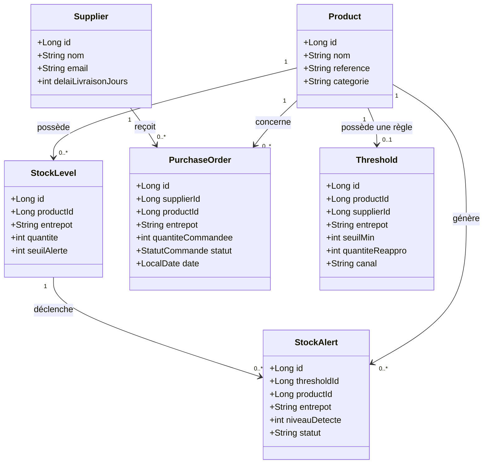
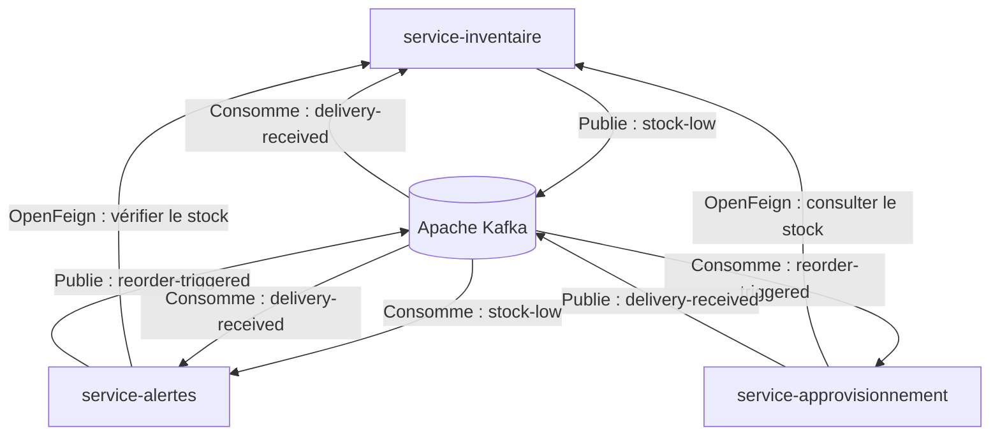
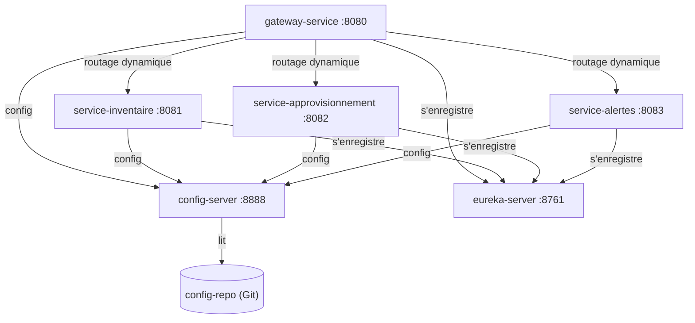

# Stock-Alert — Gestion intelligente des stocks

Application distribuée de gestion des stocks multi-entrepôts avec détection des ruptures, alertes automatiques et réapprovisionnement via des commandes d'achat.

## Présentation du projet

**Stock-Alert** vise à automatiser le cycle de réapprovisionnement. Lorsqu'une sortie de stock fait passer la quantité disponible sous un seuil défini, une alerte est créée et un processus de commande auprès d'un fournisseur est déclenché.

À la réception de la livraison, le stock est mis à jour et l'alerte correspondante est clôturée.

### Objectifs

- Gérer les produits et les stocks de plusieurs entrepôts.
- Détecter automatiquement les risques de rupture.
- Centraliser les fournisseurs et les commandes d'achat.
- Automatiser le processus de réapprovisionnement.
- Assurer la communication entre les microservices.
- Garantir le suivi du cycle de vie des commandes et des alertes.

> **Unité de traitement principale : la commande d'achat**
>
> Cycle de vie : `BROUILLON → EMISE → LIVREE`

## Architecture fonctionnelle

Le système repose sur trois microservices métier, chacun responsable d'un domaine fonctionnel distinct.

### 1. `service-inventaire`

Responsable du référentiel des produits et de la gestion des quantités par entrepôt.

| Entité | Responsabilité | Attributs principaux |
|---|---|---|
| `Product` | Référentiel des produits | `id`, `nom`, `reference`, `categorie` |
| `StockLevel` | Stock d'un produit dans un entrepôt | `id`, `productId`, `entrepot`, `quantite`, `seuilAlerte` |

### 2. `service-approvisionnement`

Service principal de gestion des fournisseurs et des commandes d'achat.

| Entité | Responsabilité | Attributs principaux |
|---|---|---|
| `Supplier` | Référentiel des fournisseurs | `id`, `nom`, `email`, `delaiLivraisonJours` |
| `PurchaseOrder` | Commande d'achat fournisseur | `id`, `supplierId`, `productId`, `entrepot`, `quantiteCommandee`, `statut`, `date` |

Chaque commande concerne un produit, un fournisseur, une quantité et un statut.

### 3. `service-alertes`

Responsable de la définition des seuils et du suivi des ruptures de stock.

| Entité | Responsabilité | Attributs principaux |
|---|---|---|
| `Threshold` | Règle de réapprovisionnement | `id`, `productId`, `supplierId`, `entrepot`, `seuilMin`, `quantiteReappro`, `canal` |
| `StockAlert` | Alerte de rupture | `id`, `thresholdId`, `productId`, `entrepot`, `niveauDetecte`, `statut` |

## Diagramme de classes UML

Ce diagramme présente les principales entités métier, leurs attributs et les relations logiques entre les produits, les stocks, les fournisseurs, les commandes et les alertes.



> Les relations de ce diagramme représentent le modèle métier cible. Elles devront correspondre aux associations et aux clés étrangères réellement implémentées dans les classes Java.

## Architecture technique

L'architecture repose sur trois microservices métier qui communiquent de manière synchrone avec OpenFeign et de manière asynchrone à travers Apache Kafka.



### Rôle des microservices

- **Inventaire :** gère les produits, les stocks et la détection des seuils bas.
- **Alertes :** gère les règles de seuil, crée les alertes et déclenche le réapprovisionnement.
- **Approvisionnement :** gère les fournisseurs, les commandes d'achat et la réception des livraisons.
- **Apache Kafka :** transporte les événements métier entre les services.

## Communication entre les microservices

### Communication synchrone — OpenFeign

OpenFeign permet à un microservice d'appeler une API REST d'un autre microservice et d'obtenir une réponse immédiate.

- **Approvisionnement → Inventaire :** consulter la quantité disponible avant de déclencher une commande d'achat.
- **Alertes → Inventaire :** vérifier que le stock est sous le seuil avant de créer une alerte.

### Communication asynchrone — Apache Kafka

Kafka permet de transmettre des événements métier sans imposer un appel direct entre le producteur et le consommateur.

| Événement | Producteur | Consommateur(s) | Traitement |
|---|---|---|---|
| `stock-low` | `service-inventaire` | `service-alertes` | Créer une alerte à partir de la règle de seuil |
| `reorder-triggered` | `service-alertes` | `service-approvisionnement` | Créer et émettre une commande d'achat |
| `delivery-received` | `service-approvisionnement` | `service-inventaire`, `service-alertes` | Mettre à jour le stock et clôturer l'alerte |

## Scénario métier : du stock bas à la livraison

1. Une sortie de stock est enregistrée dans un entrepôt.
2. Le service d'inventaire détecte que la quantité passe sous le seuil d'alerte et publie l'événement `stock-low`.
3. Le service d'alertes reçoit l'événement, vérifie le stock auprès du service d'inventaire et consulte la règle `Threshold`.
4. Une `StockAlert` est créée pour le produit et l'entrepôt concernés.
5. Le service d'alertes publie `reorder-triggered` avec les informations nécessaires au réapprovisionnement.
6. Le service d'approvisionnement identifie le fournisseur et crée une `PurchaseOrder` au statut `BROUILLON`.
7. La commande est transmise au fournisseur et son statut passe à `EMISE`.
8. À la réception de la livraison, la commande passe à `LIVREE` et l'événement `delivery-received` est publié.
9. Le service d'inventaire met à jour la quantité disponible.
10. Le service d'alertes clôture l'alerte correspondante.

## Technologies

La stack technique cible comprend :

- **Langage :** Java 17 minimum
- **Framework backend :** Spring Boot
- **Communication synchrone :** Spring Cloud OpenFeign
- **Messagerie asynchrone :** Apache Kafka
- **Persistance :** Spring Data JPA
- **Base de données :** H2 en mémoire (V1) — PostgreSQL envisagé pour la suite
- **Gestion des dépendances :** Maven
- **Environnement de développement :** IntelliJ IDEA
- **Tests d'API :** Postman, Swagger UI (springdoc-openapi)

> Cette liste correspond aux technologies envisagées pour le projet. Elle doit être ajustée selon les dépendances et les composants réellement configurés dans le dépôt.

## Structure du dépôt

```text
projetstock_alert/
├── pom.xml                      # POM agrégateur (3 modules)
├── service-inventaire/          # port 8081 — Product, StockLevel
├── service-approvisionnement/   # port 8082 — Supplier, PurchaseOrder
├── service-alertes/             # port 8083 — Threshold, StockAlert
├── postman/                     # collection de tests Postman
└── README.md
```

Chaque module est une application Spring Boot autonome, avec son propre POM, sa propre base H2 en mémoire et la même organisation en couches :

```text
com.stockalert.<service>/
├── controller/   # API REST (codes HTTP, @Valid)
├── service/      # règles métier, transactions
├── repository/   # Spring Data JPA
├── entite/       # entités JPA
├── dto/          # DTO validés (Jakarta Validation)
├── mapper/       # MapStruct entité <-> DTO
└── exception/    # exceptions métier + @RestControllerAdvice
```

## Jalon V1 — Services métier indépendants

Livrables : trois services opérationnels (Controller / Service / Repository), DTO validés, API REST avec codes HTTP adaptés et gestion centralisée des erreurs, données propres à chaque service. Aucun appel entre services à ce stade : OpenFeign et Kafka arrivent aux jalons suivants (les points d'intégration sont signalés par des commentaires `Jalon suivant` dans le code).

### Prérequis

- JDK 17 ou supérieur, Maven (ou le wrapper `mvnw` fourni), IntelliJ IDEA.

### Compiler et lancer

```powershell
.\mvnw.cmd clean verify

.\mvnw.cmd -pl service-inventaire spring-boot:run
.\mvnw.cmd -pl service-approvisionnement spring-boot:run
.\mvnw.cmd -pl service-alertes spring-boot:run
```

Dans IntelliJ : ouvrir le `pom.xml` racine (*Load Maven Project*), puis lancer chaque classe `Service...Application` (trois configurations d'exécution distinctes).

| Service | Port | Swagger UI | Console H2 |
|---|---|---|---|
| service-inventaire | 8081 | http://localhost:8081/swagger-ui/index.html | http://localhost:8081/h2-console (`jdbc:h2:mem:inventairedb`, user `sa`) |
| service-approvisionnement | 8082 | http://localhost:8082/swagger-ui/index.html | http://localhost:8082/h2-console (`jdbc:h2:mem:approvisionnementdb`) |
| service-alertes | 8083 | http://localhost:8083/swagger-ui/index.html | http://localhost:8083/h2-console (`jdbc:h2:mem:alertesdb`) |

Les bases sont recréées et alimentées par `data.sql` à chaque démarrage.

### Endpoints

**service-inventaire**

| Méthode | URL | Description | Codes |
|---|---|---|---|
| GET / POST | `/products` | Lister / créer un produit | 200 / 201, 400, 409 (référence en double) |
| GET / PUT / DELETE | `/products/{id}` | Consulter / modifier / supprimer | 200, 204, 400, 404, 409 (stock rattaché) |
| GET / POST | `/stock-levels` | Lister (`?productId=&entrepot=`) / créer | 200 / 201, 400, 404 (produit), 409 (doublon produit+entrepôt) |
| GET / PUT / DELETE | `/stock-levels/{id}` | Consulter / modifier / supprimer | 200, 204, 400, 404, 409 |
| POST | `/stock-levels/{id}/sortie` | Sortie de stock `{"quantite": n}` | 200, 400, 404, 409 (stock insuffisant) |
| POST | `/stock-levels/{id}/entree` | Entrée de stock `{"quantite": n}` | 200, 400, 404 |

**service-approvisionnement**

| Méthode | URL | Description | Codes |
|---|---|---|---|
| GET / POST | `/suppliers` | Lister / créer un fournisseur | 200 / 201, 400 |
| GET / PUT / DELETE | `/suppliers/{id}` | Consulter / modifier / supprimer | 200, 204, 400, 404, 409 (commandes rattachées) |
| GET / POST | `/purchase-orders` | Lister (`?statut=&supplierId=`) / créer (statut `BROUILLON`) | 200 / 201, 400, 404 (fournisseur) |
| GET / PUT / DELETE | `/purchase-orders/{id}` | Consulter / modifier / supprimer (`BROUILLON` seulement) | 200, 204, 400, 404, 409 |
| POST | `/purchase-orders/{id}/emettre` | `BROUILLON` → `EMISE` | 200, 404, 409 |
| POST | `/purchase-orders/{id}/livrer` | `EMISE` → `LIVREE` | 200, 404, 409 |

**service-alertes**

| Méthode | URL | Description | Codes |
|---|---|---|---|
| GET / POST | `/thresholds` | Lister / créer une règle de seuil | 200 / 201, 400, 409 (doublon produit+entrepôt) |
| GET / PUT / DELETE | `/thresholds/{id}` | Consulter / modifier / supprimer | 200, 204, 400, 404, 409 (alertes rattachées) |
| GET / POST | `/stock-alerts` | Lister (`?statut=&productId=`) / créer une alerte `OUVERTE` | 200 / 201, 400, 404 (règle), 409 (alerte ouverte existante) |
| GET / DELETE | `/stock-alerts/{id}` | Consulter / supprimer | 200, 204, 404 |
| POST | `/stock-alerts/{id}/cloturer` | `OUVERTE` → `CLOTUREE` | 200, 404, 409 |

### Format des erreurs

Toutes les erreurs renvoient le même corps JSON :

```json
{
  "timestamp": "2026-11-18T22:10:31.512",
  "status": 400,
  "erreur": "Bad Request",
  "message": "Données de la requête invalides",
  "chemin": "/products",
  "details": ["nom : Le nom est obligatoire", "reference : La référence est obligatoire"]
}
```

| Code | Cas |
|---|---|
| 400 | Validation du DTO, JSON mal formé, énumération ou identifiant de type incorrect |
| 404 | Ressource inexistante (y compris produit/fournisseur/règle référencé dans le corps) |
| 409 | Conflit métier : doublon, transition de statut interdite, stock insuffisant, suppression d'une ressource encore utilisée |

### Tests

Importer `postman/Stock-Alert-v1.postman_collection.json` dans Postman, démarrer les trois services, puis exécuter chaque dossier avec le **Collection Runner** (dans l'ordre : les identifiants créés sont enchaînés par des variables). La collection contient 72 requêtes avec assertions couvrant les cas valides, les erreurs de validation (400), les ressources inexistantes (404) et les conflits (409). Swagger UI permet aussi de tester manuellement chaque service.

### Choix de conception pour la V1

- Les références entre services (`productId`, `supplierId`, `thresholdId` hors du service propriétaire) sont de simples `Long` sans contrainte de clé étrangère : chaque service reste autonome. La vérification se fait au jalon suivant via OpenFeign.
- Une `PurchaseOrder` naît toujours en `BROUILLON` (date du jour) ; seul un brouillon peut être modifié ou supprimé.
- Une `StockAlert` reprend `productId` et `entrepot` de sa règle `Threshold` ; le niveau détecté doit être inférieur à `seuilMin`, et une seule alerte `OUVERTE` est admise par règle.
- La livraison d'une commande (`livrer`) ne met pas encore le stock à jour et ne clôture pas l'alerte : ce sera le rôle de l'événement Kafka `delivery-received`.

## Tests et validation

Les tests devront couvrir les principaux scénarios métier :

- Consultation du stock par produit et par entrepôt.
- Détection d'un seuil d'alerte dépassé.
- Création et clôture d'une alerte.
- Déclenchement du réapprovisionnement.
- Création et changement d'état d'une commande d'achat.
- Réception d'une livraison et mise à jour du stock.
- Communication entre les microservices via OpenFeign.
- Publication et consommation des événements Kafka.
- Gestion des erreurs et des événements reçus plusieurs fois.

## Évolutions prévues

- Ajouter des tests unitaires et des tests d'intégration.
- Mettre en place la découverte des services avec Eureka si nécessaire.
- Centraliser la configuration avec Spring Cloud Config si nécessaire.
- Ajouter une gestion robuste des erreurs et des nouvelles tentatives Kafka.
- Prévenir les doublons lors du traitement des événements.
- Conteneuriser les microservices et leurs dépendances avec Docker Compose.
- Ajouter un tableau de bord de suivi des stocks et des alertes.

## Auteur

**Aya Jarmouni**

Projet académique — Architecture microservices et automatisation de la gestion des stocks.

## Jalon V2 — Infrastructure Spring Cloud (Eureka + Gateway)

Deux nouveaux modules d'infrastructure, et les trois services métier s'enregistrent désormais auprès d'Eureka.

| Module | Port | Rôle |
|---|---|---|
| eureka-server | 8761 | Registre de services (`service-registry`), dashboard http://localhost:8761 |
| gateway-service | 8080 | API Gateway réactive (Spring Cloud Gateway WebFlux) |

### Ordre de démarrage

1. `ServiceRegistryApplication` (Eureka, 8761)
2. `ServiceInventaireApplication`, `ServiceApprovisionnementApplication`, `ServiceAlertesApplication`
3. `GatewayServiceApplication` (8080)

### Routage dynamique (profil par défaut)

Le *discovery locator* crée les routes à partir des services découverts, sans aucune route déclarée :

- http://localhost:8080/service-inventaire/products
- http://localhost:8080/service-inventaire/stock-levels
- http://localhost:8080/service-approvisionnement/suppliers
- http://localhost:8080/service-approvisionnement/purchase-orders
- http://localhost:8080/service-alertes/thresholds
- http://localhost:8080/service-alertes/stock-alerts

Un nouveau service qui rejoint Eureka devient accessible via la Gateway sans modifier ni redémarrer celle-ci.

### Routage statique (profil `statique`)

Lancer la Gateway avec `-Dspring.profiles.active=statique` (VM options IntelliJ). Les chemins sont alors exposés sans préfixe de service : `http://localhost:8080/products`, `/suppliers`, `/thresholds`, etc. (`lb://` + Eureka pour résoudre les instances).

## Jalon V3 — Centralisation des configurations (Spring Cloud Config)

Les configurations des services sont externalisées dans le dossier `config-repo/` (versionné sur Git) et servies par un nouveau module `config-server`.

| Module | Port | Rôle |
|---|---|---|
| config-server | 8888 | Serveur de configuration (Spring Cloud Config), lit le dossier `config-repo/` du dépôt Git |

### Contenu de `config-repo/`

| Fichier | Contenu |
|---|---|
| `application.properties` | Propriétés communes : URL Eureka, exposition actuator |
| `service-inventaire.properties` | Port 8081, H2, JPA, jeu de données |
| `service-approvisionnement.properties` | Port 8082, H2, JPA, jeu de données |
| `service-alertes.properties` | Port 8083, H2, JPA, jeu de données |
| `gateway-service.properties` | Port 8080, routage dynamique (discovery locator) |

Eureka et le Config Server restent en configuration locale (problème d'amorçage : ils doivent démarrer avant les autres services).

### Fonctionnement

Chaque service ne contient plus que :

```properties
spring.application.name=<nom-du-service>
spring.config.import=configserver:http://localhost:8888
```

Au démarrage, le service récupère auprès du Config Server le fichier `application.properties` (global) puis `<nom-du-service>.properties`. Sans Config Server, le service refuse de démarrer (fail-fast).

### Ordre de démarrage

1. `ServiceRegistryApplication` (Eureka, 8761)
2. `ConfigServerApplication` (Config Server, 8888)
3. `ServiceInventaireApplication`, `ServiceApprovisionnementApplication`, `ServiceAlertesApplication`
4. `GatewayServiceApplication` (8080)

### Vérification

- http://localhost:8888/service-inventaire/default
- http://localhost:8888/service-approvisionnement/default
- http://localhost:8888/service-alertes/default
- http://localhost:8888/gateway-service/default
- Eureka (http://localhost:8761) : les 4 instances sont `UP`
- http://localhost:8080/service-inventaire/products (via la Gateway)

### Schéma d'architecture (V3)



